# Infrastructure Réseau Multisites

**Dossier de réalisation technique** · Orion Consulting Group

| Version | Création | Révision | Auteur |
|:-:|:-:|:-:|:-:|
| 2.0 | 29/11/2025 | 21/02/2026 | Nathan LALLIER |

Version PDF : [DRT-ORION-Consulting-Group.pdf](DRT-ORION-Consulting-Group.pdf)

## Introduction Générale

### Contexte et Présentation de l’Entreprise

ORION CONSULTING GROUP est un cabinet de conseil en transformation numérique, comptant une quarantaine de collaborateurs répartis sur deux implantations géographiques distinctes :

- **Bâtiment 1 (Siège social)** : Héberge la Direction Générale, les Ressources Humaines, le service Comptabilité, le pôle IT et l'ensemble des services d'infrastructure critiques (Active Directory, Supervision, Gestion de parc, site vitrine).
- **Bâtiment 2 (Pôle technique)** : Accueille une antenne du service IT, une équipe de développement et un espace de travail collaboratif avec accès Wi-Fi.

À la suite d'une phase de croissance rapide, la direction a mandaté le service IT interne pour concevoir et déployer une infrastructure réseau sécurisée, centralisée et évolutive, capable de répondre aux enjeux suivants :

- Permettre une communication sécurisée entre les deux sites via un tunnel VPN.
- Garantir la séparation des flux réseau entre les différents services métier.
- Centraliser la gestion des identités et des ressources informatiques.
- Assurer la supervision proactive de l'ensemble du parc.
- Exposer un site vitrine public dans une zone isolée (DMZ).

### Expression du Besoin

Le projet répond aux exigences métier suivantes, formalisées par la Direction des Systèmes d'Information :

- **Accessibilité** : Les collaborateurs des deux sites doivent accéder de manière transparente aux ressources partagées (fichiers, applications internes), comme s'ils se trouvaient sur un réseau unique.
- **Segmentation** : Les flux réseaux doivent être cloisonnés par service (Direction, RH, Comptabilité, IT, Développement) afin de limiter la surface d'attaque et de contenir les risques de propagation latérale en cas d'incident de sécurité.
- **Disponibilité** : Les services exposés au public (site vitrine) doivent être isolés dans une zone démilitarisée (DMZ), sans accès direct au réseau interne.
- **Résilience** : Les services critiques (annuaire, DNS, fichiers) doivent être répliqués sur le site distant pour garantir la continuité d'activité en cas de défaillance du site principal.
- **Gouvernance** : L'administration du parc informatique doit être centralisée via un annuaire Active Directory, complété par un outil de supervision (Zabbix) et un outil de gestion de parc (GLPI).

### Objectifs du Dossier

Ce document, intitulé Dossier de Réalisation Technique (DRT), a pour vocation de :

- Documenter l'intégralité des étapes de conception et de configuration de l'infrastructure.
- Justifier chaque choix technologique et architectural par une analyse des besoins.
- Servir de référentiel technique pour la maintenance et l'évolution future de l'infrastructure.
- Démontrer la maîtrise des compétences du référentiel BTS SIO SISR : Installation, Configuration, Sécurisation et Supervision d'une infrastructure réseau.

## Analyse et Cadrage du Projet

### Cahier des Charges Fonctionnel

Le tableau ci-dessous synthétise les exigences fonctionnelles et les réponses techniques retenues :

| Exigence Fonctionnelle | Solution Technique Retenue |
|:----------------------------:|------------------------------------------|
| Communication sécurisée inter-sites | Tunnel VPN IPsec entre les pare-feux pfSense |
| Segmentation des flux par service | VLANs 802.1Q avec routage inter-VLAN via pfSense |
| Gestion centralisée des identités | Active Directory Domain Services (Windows Server 2025) |
| Résilience de l'annuaire | Contrôleur de domaine secondaire (réplication AD) sur le site distant |
| Partage de fichiers centralisé | Serveur de fichiers sur RIGEL avec réplication DFS-R vers VEGA |
| Exposition publique du site vitrine | Serveur Nginx en DMZ (MEISSA) |
| Supervision proactive du parc | Zabbix Server sur SULAFAT avec agents déployés sur toutes les machines |
| Inventaire et gestion de parc | GLPI sur BELLATRIX avec liaison LDAPS vers l'Active Directory |
| Portail d'administration centralisé | Interface web sur BELLATRIX redirigeant vers tous les outils |
| Déploiement automatisé des agents | GPO pour la distribution des agents Zabbix et GLPI sur les postes clients |

### Étude des Contraintes Techniques

L'infrastructure est déployée dans un environnement pédagogique soumis à des contraintes strictes imposées par l'administrateur système de l'établissement :

| Type de contrainte | Description |
|:-----------------:|-----------------------------------------------------|
| Environnement | Virtualisation sous VMware ESXi (accès restreint à la configuration de l’hôte) |
| Ressources | 9 machines virtuelles pré-provisionnées (avec ressources limitées) |
| Connectivité | Utilisation obligatoire de l’Upstream Gateway 10.10.255.254 pour l’accès externe |
| Adressage | Respect rigoureux du plan IP imposé par l’établissement (plages 10.11.75.0/24 et 10.11.76.0/24) |
| Sécurité | Chiffrement impératif des flux inter-sites via les pare-feux pfSense |

Ces contraintes ont guidé l'ensemble des choix d'architecture, notamment l'utilisation de solutions légères et la mutualisation des rôles sur certaines machines (BELLATRIX héberge GLPI et le portail d'administration).

### Tableau de Synthèse du Matériel et OS

| Nom de la VM | OS | Rôle(s) | Bâtiment |
|:------------:|----------------|--------------------------------|-----------|
| ORION | pfSense 2.7.2 | Pare-feu / Routeur / VPN IPsec / DHCP | 1 |
| RIGEL | Windows Server 2025 | AD DS (Principal) / DNS / Serveur de Fichiers | 1 |
| MEISSA | Ubuntu 24.04 | Serveur Web Nginx (DMZ) | 1 |
| BELLATRIX | Ubuntu 24.04 | GLPI / Portail d’Administration | 1 |
| PC-CLIENT-01 | Windows 11 | Poste de travail utilisateur | 1 |
| LYRA | pfSense 2.7.2 | Pare-feu / Routeur / VPN IPsec / DHCP | 2 |
| VEGA | Windows Server 2025 | AD DS (Secondaire) / DNS / Réplication Fichiers | 2 |
| SULAFAT | Ubuntu 24.04 | Supervision avec Zabbix | 2 |
| PC-CLIENT-02 | Windows 11 | Poste de travail utilisateur | 2 |

## Ingénierie Réseau et Adressage

### Architecture Cible et Topologie Logique

L'architecture repose sur une topologie en étoile autour de deux pare-feux pfSense, chacun agissant comme routeur de bordure et passerelle par défaut pour l'ensemble des réseaux locaux de son site.

Les deux sites sont interconnectés via un tunnel VPN IPsec site-à-site, permettant une communication transparente entre les sous-réseaux internes sans exposer les flux sur le réseau de l'établissement.

L'infrastructure se décompose en deux zones principales :

- **Bâtiment 1 (ORION)** : Siège social hébergeant le centre de données principal avec le contrôleur de domaine maître (RIGEL) et la gestion de parc (BELLATRIX), ainsi que la zone publique DMZ (MEISSA).
- **Bâtiment 2 (LYRA)** : Pôle technique disposant de son propre contrôleur de domaine répliqué (VEGA), de ses postes clients et d'un serveur de supervision Zabbix (SULAFAT).

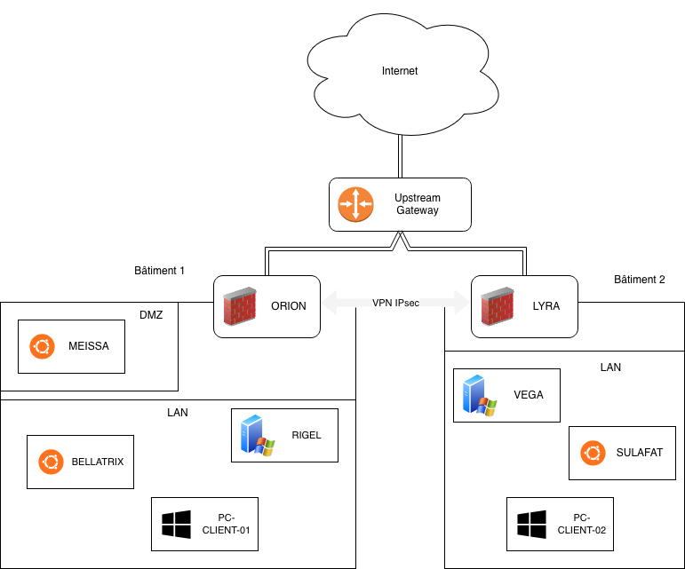

### Stratégie de Segmentation (VLANs)

Afin de répondre aux exigences de sécurité et d'optimisation des flux, nous avons opté pour un découpage logique via la norme IEEE 802.1Q (VLANs). Ce choix repose sur trois principes fondamentaux :

- **Cloisonnement des domaines de diffusion (Broadcast)** : Chaque VLAN constitue un domaine de broadcast isolé, ce qui réduit la charge réseau inutile et empêche un poste du service Comptabilité de "voir" directement les machines du pôle IT.
- **Contrôle des accès inter-services** : Tout trafic entre VLANs transite obligatoirement par le pare-feu, ce qui permet d'appliquer des règles de filtrage granulaires (principe du moindre privilège).
- **Flexibilité opérationnelle** : L'appartenance à un réseau logique ne dépend plus du port physique du switch mais de la configuration 802.1Q, facilitant les réorganisations futures.

Le tableau ci-dessous résume l'affectation des VLANs par site :

| VLAN ID | Nom | Affectation | Site(s) |
|:---------:|-------------|--------------------------------------|-----------|
| – | WAN | Liaison vers l’Upstream Gateway de l’établissement | 1 et 2 |
| – | DMZ | Zone démilitarisée (serveur web exposé) | 1 et 2 |
| – | LAN (Natif) | Segment d’administration et serveurs critiques | 1 et 2 |
| 10 | DIRECTION | Postes de la Direction Générale | 1 |
| 20 | DRH | Postes des Ressources Humaines | 1 |
| 30 | COMPTA | Postes du Service Comptabilité | 1 |
| 40 | IT | Postes du Service Informatique | 1 et 2 |
| 50 | WIFI | Point d’accès sans fil | 1 et 2 |
| 60 | DEV | Postes du pôle Développement | 2 |

### Plan d'Adressage IP (VLSM)

Les contraintes imposées par l'administration de l'établissement (plages 10.11.75.0/24 et 10.11.76.0/24) nécessitent l'utilisation de masques à longueur variable (VLSM). Nous avons standardisé l'utilisation de masques en /28 (255.255.255.240), offrant 14 adresses hôtes par sous-réseau, ce qui est suffisant pour le dimensionnement actuel tout en restant économe en adresses.

**Bâtiment 1 — Plan d'adressage :**

| VLAN | Service    | Réseau   | Masque | Passerelle | Mode |
|:-------:|---------------|---------------|----------|---------------|----------|
|    –    | WAN (Internet) | 10.10.101.75 | /16        | 10.10.255.254  | Statique |
|    –    | DMZ            | 10.11.75.0   | /28        | 10.11.75.14    | Statique |
|    10    | Direction      | 10.11.75.16  | /28        | 10.11.75.30    | DHCP     |
|    20    | DRH            | 10.11.75.32  | /28        | 10.11.75.46    | DHCP     |
|    30    | Comptabilité   | 10.11.75.48  | /28        | 10.11.75.62    | DHCP     |
|    40    | IT             | 10.11.75.64  | /28        | 10.11.75.78    | DHCP     |
|    50    | WiFi           | 10.11.75.80  | /28        | 10.11.75.94    | DHCP     |
|    –    | LAN (Serveurs) | 10.11.75.240 | /28        | 10.11.75.254   | Statique |

**Bâtiment 2 — Plan d'adressage :**

| VLAN | Service    | Réseau   | Masque | Passerelle | Mode |
|:-------:|---------------|---------------|----------|---------------|----------|
|    –    | WAN (Internet) | 10.10.101.76 | /16        | 10.10.255.254  | Statique |
|    –    | DMZ            | 10.11.76.0   | /28        | 10.11.76.14    | Statique |
|    40    | IT             | 10.11.76.16  | /28        | 10.11.76.30    | DHCP     |
|    50    | WiFi           | 10.11.76.32  | /28        | 10.11.76.46    | DHCP     |
|    60    | Dev            | 10.11.76.48  | /28        | 10.11.76.62    | DHCP     |
|    –    | LAN (Serveurs) | 10.11.76.240 | /28        | 10.11.76.254   | Statique |

**Adressage statique des serveurs :**

| Machine | Adresse IP | Masque | Passerelle | DNS Primaire | DNS Secondaire |
|:--------:|-------------|----------|--------------|--------------|-------------|
| RIGEL | 10.11.75.241 | /28 | 10.11.75.254 | 127.0.0.1 | 10.11.76.241 |
| BELLATRIX | 10.11.75.242 | /28 | 10.11.75.254 | 10.11.75.241 | 10.11.76.241 |
| MEISSA | 10.11.75.1 | /28 | 10.11.75.14 | 10.11.75.241 | 10.11.76.241 |
| VEGA | 10.11.76.241 | /28 | 10.11.76.254 | 10.11.75.241 | 127.0.0.1 |
| SULAFAT | 10.11.76.242 | /28 | 10.11.76.254 | 10.11.75.241 | 10.11.76.241 |

## Mise en Œuvre du Socle Réseau Site Principal (Bâtiment 1)

### Initialisation du Pare-feu ORION (WAN et Routage)

Le pare-feu ORION constitue le point d'entrée du Bâtiment 1. La première étape critique de l'implémentation consiste à établir la connectivité avec le réseau de l'établissement scolaire (réseau "Upstream").

Cette étape présente une spécificité technique importante : la passerelle par défaut (10.10.255.254) se situe en dehors du sous-réseau directement connecté à notre interface WAN (10.10.101.75/16), et n'est pas distribuée par DHCP. Il est donc nécessaire de la déclarer manuellement.

**Configuration appliquée :**

1. **Adressage de l'interface WAN :**
   - Type de configuration : IPv4 Static
   - Adresse IP : 10.10.101.75
   - Masque : /16 (255.255.0.0)
2. **Déclaration de la Passerelle Amont (Upstream Gateway) :**
   - Chemin : System > Routing > Gateways
   - Nom : GW_ECOLE
   - IP Gateway : 10.10.255.254
   - Cette passerelle a été définie comme Default Gateway IPv4 pour acheminer tout le trafic sortant des réseaux internes vers Internet.
3. **Autorisation des flux privés (RFC 1918) :** Par défaut, pfSense bloque le trafic entrant provenant d'adresses privées sur l'interface WAN (protection contre le spoofing). Or, notre adresse WAN est elle-même une adresse privée de classe A (10.x.x.x). Il a donc été nécessaire de décocher les options "Block private networks" et "Block bogon networks" dans les paramètres de l'interface WAN, sans quoi l'intégralité du trafic légitime aurait été rejetée.

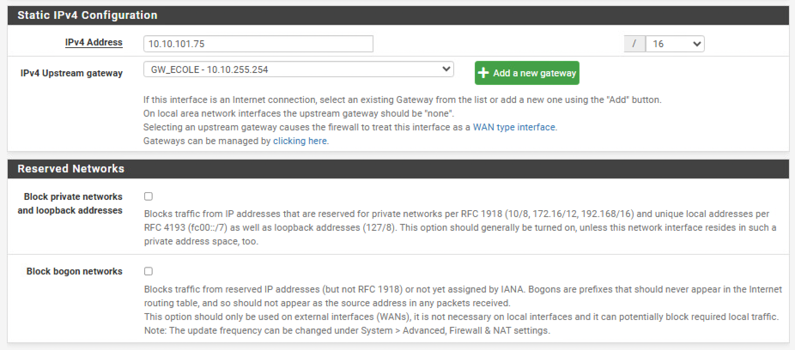

### Segmentation du Réseau Local (VLANs)

Afin d'assurer l'étanchéité entre les services et de respecter le schéma directeur, nous avons configuré l'interface LAN physique d'ORION pour gérer le marquage de trames IEEE 802.1Q.

**Procédure technique appliquée :**

1. Accès à Interfaces > Assignments > VLANs, puis création des interfaces virtuelles rattachées à l'interface physique LAN.
2. Attribution des identifiants (Tags) correspondants au plan d'adressage validé : VLAN 10 (Direction), VLAN 20 (DRH), VLAN 30 (Compta), VLAN 40 (IT), VLAN 50 (WiFi).
3. Accès à Interfaces > Assignments, puis assignation de chaque VLAN à une interface logique nommée (VLAN10_DIRECTION, VLAN20_DRH, etc.).
4. Activation de chaque interface et configuration de l'adresse IP statique correspondant à la passerelle du sous-réseau (dernière adresse utilisable).

Après configuration, le tableau des interfaces d'ORION se présente ainsi :

|  Interface   | Adresse IP |
|:----------------:|----------------|
|       WAN        | 10.10.101.75   |
|       LAN        | 10.11.75.254   |
|       DMZ        | 10.11.75.14    |
| VLAN10_DIRECTION | 10.11.75.30    |
|    VLAN20_DRH    | 10.11.75.46    |
|  VLAN30_COMPTA   | 10.11.75.62    |
|    VLAN40_IT     | 10.11.75.78    |
|   VLAN50_WIFI    | 10.11.75.94    |

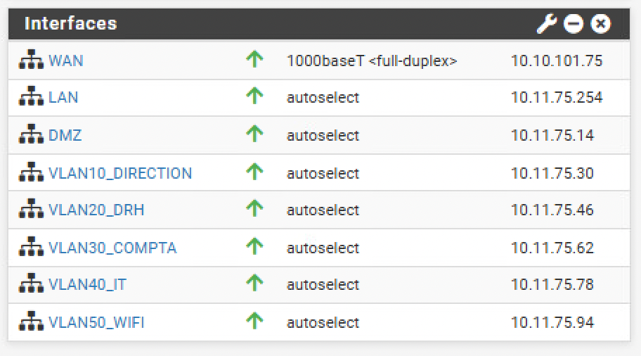

### Configuration des Services DHCP

Pour faciliter la gestion du parc et éviter les erreurs de configuration manuelle sur les postes clients, le service DHCP a été activé sur chaque interface de réseau local utilisateur. Les segments à adressage statique (DMZ et LAN Serveurs) sont exclus du service DHCP.

**Principe de répartition des plages :** Chaque VLAN dispose d'une plage d'adresses dédiée, calculée pour réserver les premières adresses du sous-réseau aux équipements d'infrastructure (imprimantes, points d'accès, serveurs) et allouer le reste aux clients dynamiques.

**Exemple détaillé — VLAN 10 (Direction) :**

- Sous-réseau : 10.11.75.16/28
- Plage utilisable : 10.11.75.17 à 10.11.75.30
- Plage DHCP configurée : 10.11.75.20 à 10.11.75.29 (10 adresses dynamiques)
- Adresses réservées (17-19) : Futures imprimantes ou équipements de la Direction
- Serveurs DNS distribués : DNS publics en phase initiale (1.1.1.1 / 8.8.8.8), basculés ensuite vers le contrôleur de domaine RIGEL (10.11.75.241)

La même logique a été appliquée aux VLANs 20, 30, 40 et 50.

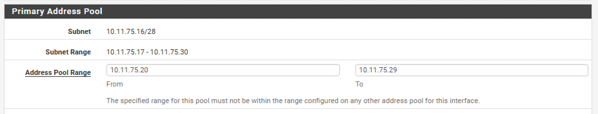

### Politique de Filtrage Initiale (Firewalling)

Par défaut, pfSense applique une politique de "Deny All" : tout trafic qui n'est pas explicitement autorisé par une règle est rejeté. Pour rendre l'infrastructure opérationnelle lors de la phase de mise en service, une politique de filtrage initiale permissive a été déployée.

**Règles initiales mises en place (par interface VLAN) :**

- Action : Pass
- Protocole : IPv4 Any
- Source : VLAN10_DIRECTION subnets (réseau local de l'interface)
- Destination : Any
- Objectif : Permettre aux hôtes d'accéder aux services de mise à jour (Windows Update, dépôts APT), à la navigation web et aux tests de connectivité.

> [!NOTE]
> **Justification :** Cette configuration est explicitement une étape transitoire dite de "mise en service". L'objectif est de valider le bon fonctionnement de la couche réseau (routage, NAT, DHCP) avant d'implémenter les règles restrictives définitives (principe du moindre privilège). La section 9 de ce dossier détaille la politique de filtrage avancée déployée après l'installation de tous les services.

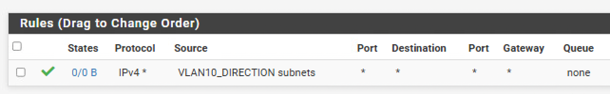

### Tests de Connectivité et Validation du Socle

Une fois le routage, les VLANs et le DHCP configurés, une phase de tests unitaires est indispensable pour valider le bon fonctionnement du Bâtiment 1 avant de poursuivre le déploiement.

**Protocole de test :** Les tests sont réalisés depuis le poste PC-CLIENT-01 positionné (via l'hyperviseur) dans le VLAN 40 (IT).

| Objectif du test | Commande | Résultat attendu | Statut |
|:----------------:|------------------|-------------------------|------------|
| Attribution IP via DHCP | `ipconfig /all` | Adresse dans la plage 10.11.75.67-76, passerelle .78 | ☐ |
| Liaison locale (passerelle) | `ping 10.11.75.78` | Réponse de la passerelle pfSense | ☐ |
| Sortie Internet (IP) | `ping 8.8.8.8` | Réponse du serveur DNS Google | ☐ |
| Résolution DNS externe | `nslookup google.fr` | Traduction du nom en adresse IP | ☐ |
| Accès au LAN Serveurs | `ping 10.11.75.254` | Réponse de l’interface LAN d’ORION | ☐ |

## Mise en Œuvre du Socle Réseau Site Distant (Bâtiment 2)

### Déploiement du Pare-feu LYRA

Le site distant (Bâtiment 2) est architecturé autour du pare-feu LYRA. La méthodologie de configuration est identique à celle du site principal, mais l'adressage répond au plan spécifique du Bâtiment 2 (10.11.76.0/24) et intègre un segment dédié au pôle Développement (VLAN 60).

**Configuration de l'interface WAN :**

- Adressage statique : 10.10.101.76/16
- Passerelle par défaut : GW_ECOLE — 10.10.255.254
- Options "Block private networks" et "Block bogon networks" : désactivées (même justification que pour ORION).

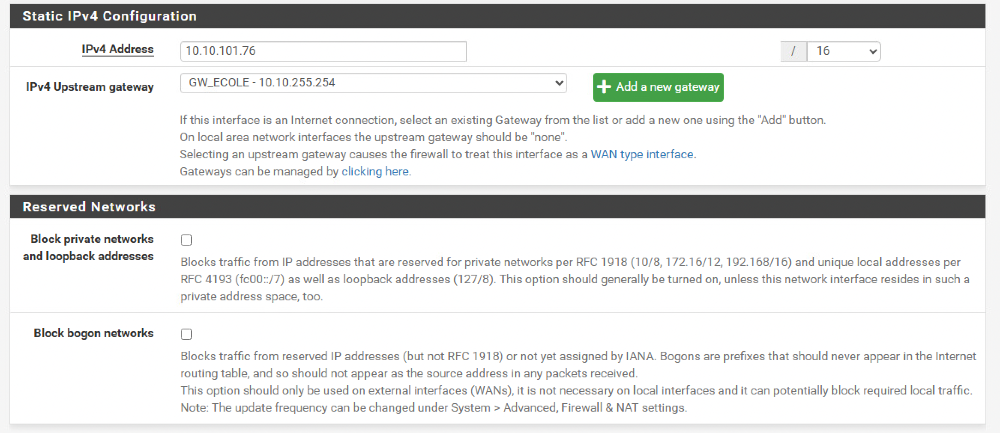

### Segmentation et Adressage Local

La segmentation 802.1Q a été implémentée sur l'interface LAN de LYRA pour isoler les trois zones utilisateurs du Bâtiment 2 :

| Interface | Adresse IP |
|:-------------:|----------------|
|      WAN      | 10.10.101.76   |
|      LAN      | 10.11.76.254   |
|      DMZ      | 10.11.76.14    |
|   VLAN40_IT   | 10.11.76.30    |
|  VLAN50_WIFI  | 10.11.76.46    |
|  VLAN60_DEV   | 10.11.76.62    |

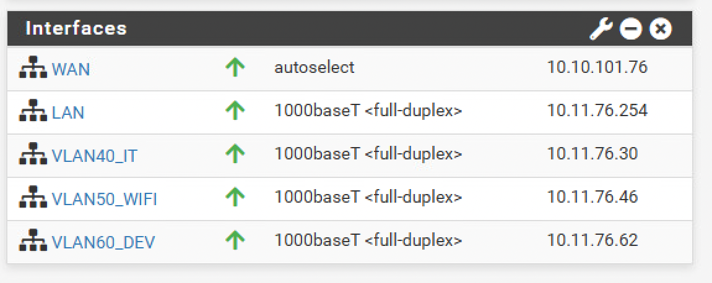

### Automatisation de l'Adressage (DHCP)

Le service DHCP a été activé sur LYRA pour les réseaux utilisateurs (VLAN 40, 50, 60). Chaque pool d'adresses offre environ 10 adresses dynamiques, réservant les premières pour les équipements d'infrastructure.

**Spécificité :** En phase initiale, les clients reçoivent les DNS publics (1.1.1.1). Ces serveurs DNS seront remplacés par l'IP de VEGA (10.11.76.241) une fois le contrôleur de domaine secondaire déployé et opérationnel (section 7.5).

### Validation de la Connectivité du Bâtiment 2

Les tests unitaires ont été réalisés depuis PC-CLIENT-02 positionné dans le VLAN 40 (IT) du Bâtiment 2 :

| Objectif du test | Commande | Résultat attendu | Statut |
|:----------------:|------------------|-------------------------|------------|
| Attribution IP via DHCP | `ipconfig /all` | Adresse dans la plage VLAN 40 du Bât. 2 | ☐ |
| Liaison locale (passerelle) | `ping 10.11.76.30` | Réponse de la passerelle pfSense (LYRA) | ☐ |
| Sortie Internet (IP) | `ping 8.8.8.8` | Réponse du serveur DNS Google | ☐ |
| Résolution DNS externe | `nslookup google.fr` | Traduction du nom en adresse IP | ☐ |
| Accès au LAN Serveurs | `ping 10.11.76.254` | Réponse de l’interface LAN de LYRA | ☐ |

## Interconnexion Sécurisée des Sites (VPN IPsec)

### Étude du Besoin et Choix du Protocole

Les deux bâtiments d'ORION CONSULTING GROUP sont reliés par le réseau de l'établissement scolaire, un réseau partagé et non maîtrisé par l'entreprise. Tout trafic inter-sites transitant en clair sur ce réseau serait potentiellement interceptable (credentials AD, fichiers partagés, flux de supervision).

Le choix s'est porté sur **IPsec en mode tunnel (IKEv2)** pour les raisons suivantes :

- **Chiffrement fort** : Les flux entre les deux sites sont chiffrés de bout en bout (AES-256).
- **Authentification mutuelle** : Les deux pare-feux s'authentifient via une clé pré-partagée (PSK) avant d'établir le tunnel.
- **Intégration native** : pfSense intègre un module IPsec complet sans nécessiter de paquet additionnel.
- **Transparence** : Une fois le tunnel établi, les machines internes communiquent comme si elles étaient sur un réseau local unique.

### Configuration du Tunnel IPsec - Côté ORION

**Phase 1 (IKE — Négociation de la SA) :**

|     Paramètre     | Valeur                 |
|:---------------------:|----------------------------|
|        Version        | IKEv2                      |
|    Remote Gateway     | 10.10.101.76 (WAN de LYRA) |
| Authentication Method | Mutual PSK                 |
|    Pre-Shared Key     | *(masquée)*                |
| Encryption Algorithm  | AES 256 bits               |
|    Hash Algorithm     | SHA-256                    |
|       DH Group        | 14 (2048 bits)             |
|       Lifetime        | 28800 secondes             |

**Phase 2 (ESP — Tunnel de données) :**

|    Paramètre     | Valeur                   |
|:--------------------:|------------------------------|
|         Mode         | Tunnel IPv4                  |
|    Local Network     | LAN Subnet : 10.11.75.240/28 |
|    Remote Network    | LAN Subnet : 10.11.76.240/28 |
| Encryption Algorithm | AES 256 bits                 |
|    Hash Algorithm    | SHA-256                      |
|    PFS Key Group     | 14                           |
|       Lifetime       | 28800 secondes               |

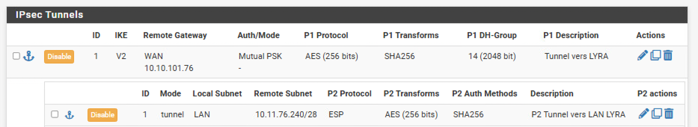

### Configuration du Tunnel IPsec - Côté LYRA

La configuration miroir a été appliquée sur LYRA, en inversant les réseaux locaux et distants :

**Phase 1 (IKE — Négociation de la SA) :**

|     Paramètre     | Valeur                 |
|:---------------------:|----------------------------|
|        Version        | IKEv2                      |
|    Remote Gateway     | 10.10.101.75 (WAN d’ORION) |
| Authentication Method | Mutual PSK                 |
|    Pre-Shared Key     | *(masquée)*                |
| Encryption Algorithm  | AES 256 bits               |
|    Hash Algorithm     | SHA-256                    |
|       DH Group        | 14 (2048 bits)             |
|       Lifetime        | 28800 secondes             |

**Phase 2 (ESP — Tunnel de données) :**

|    Paramètre     | Valeur                   |
|:--------------------:|------------------------------|
|         Mode         | Tunnel IPv4                  |
|    Local Network     | LAN Subnet : 10.11.76.240/28 |
|    Remote Network    | LAN Subnet : 10.11.75.240/28 |
| Encryption Algorithm | AES 256 bits                 |
|    Hash Algorithm    | SHA-256                      |
|    PFS Key Group     | 14                           |
|       Lifetime       | 28800 secondes               |

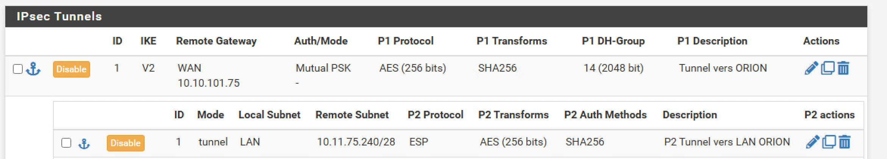

### Règles de Filtrage pour le Tunnel

Pour que le trafic puisse effectivement transiter dans le tunnel, des règles de filtrage doivent être ajoutées sur l'interface virtuelle IPsec de chaque pare-feu.

**Règle appliquée sur les deux pare-feux (interface IPsec) :**

- Action : Pass
- Protocole : Any
- Source : Réseau distant (ex : 10.11.76.240/28 sur ORION)
- Destination : Réseau local (ex : 10.11.75.240/28 sur ORION)

> [!NOTE]
> En phase de mise en service, cette règle est volontairement large (Any/Any). Elle sera affinée dans la section 9 pour ne laisser passer que les flux nécessaires (réplication AD, DNS, DFS-R, ICMP, supervision Zabbix).

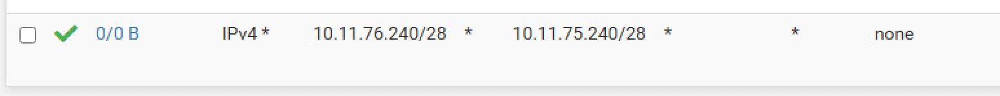

### Tests et Validation de l'Interconnexion

#### Vérification de l'état du tunnel

- Chemin : Status > IPsec sur ORION et LYRA
- Résultat attendu : Phase 1 "Established" et Phase 2 "Installed"

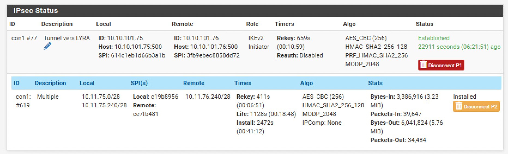

#### Tests de connectivité inter-sites

| Test | Depuis | Vers | Commande | Statut |
|:-------------:|------------------|-------------------|------------|----------|
| Ping passerelle distante | PC-CLIENT-01 (Bât. 1) | 10.11.76.254 (LAN LYRA) | `ping 10.11.76.254` | ☐ |
| Ping serveur distant | PC-CLIENT-01 (Bât. 1) | 10.11.76.241 (VEGA) | `ping 10.11.76.241` | ☐ |
| Ping passerelle locale | PC-CLIENT-02 (Bât. 2) | 10.11.75.254 (LAN ORION) | `ping 10.11.75.254` | ☐ |
| Ping DC principal | PC-CLIENT-02 (Bât. 2) | 10.11.75.241 (RIGEL) | `ping 10.11.75.241` | ☐ |

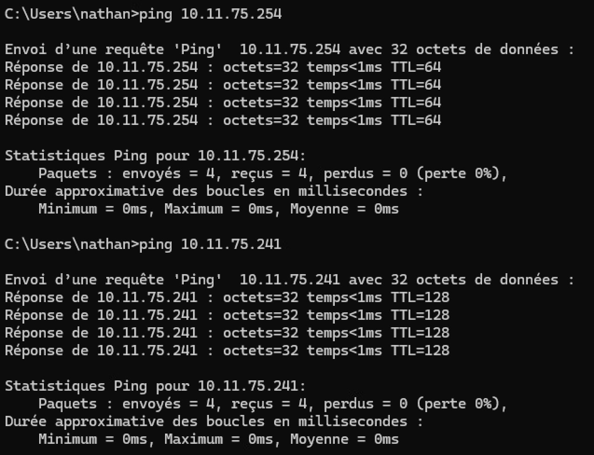

## Services d'Annuaire et d'Identité (Active Directory)

### Étude du Besoin et Choix Technique

L'interconnexion des deux bâtiments crée le besoin d'une gestion centralisée des identités et des ressources. Les collaborateurs doivent pouvoir s'authentifier avec un compte unique, quel que soit le site sur lequel ils se trouvent, et les administrateurs doivent pouvoir gérer les droits et les stratégies de sécurité depuis un point central.

Le choix s'est porté sur **Active Directory Domain Services (AD DS)** sous **Windows Server 2025**, pour les raisons suivantes :

- **Centralisation** : Gestion unifiée des comptes utilisateurs, des groupes et des machines pour les deux sites.

- **Sécurité** : Application de stratégies de groupe (GPO) homogènes sur l'ensemble du domaine.
- **Résilience** : Possibilité de déployer un contrôleur de domaine secondaire sur le site distant pour assurer la continuité d'activité.
- **Fonctionnalités avancées** : Windows Server 2025 apporte le support natif de DNS over HTTPS (DoH), une résilience améliorée de la base NTDS et un chiffrement Kerberos renforcé.

**Architecture AD cible :**

- Forêt mono-domaine : galaxynl.lan
- Niveau fonctionnel : Windows Server 2025
- RIGEL (Bât. 1) : Contrôleur de domaine principal + Catalogue Global + DNS
- VEGA (Bât. 2) : Contrôleur de domaine secondaire + Catalogue Global + DNS (réplication via le tunnel IPsec)

### Déploiement du Contrôleur Principal RIGEL

#### Préparation et Adressage

Le serveur RIGEL est positionné sur le segment LAN Natif (non-taggué), réservé à l'administration et aux services critiques de l'infrastructure.

**Configuration réseau appliquée :**

- Adresse IPv4 : 10.11.75.241
- Masque de sous-réseau : 255.255.255.240 (/28)
- Passerelle par défaut : 10.11.75.254 (Interface LAN d'ORION)
- Serveur DNS préféré : 127.0.0.1 (boucle locale — le rôle DNS sera installé localement)

**Prérequis validés avant l'installation :**

- Nom d'hôte défini : RIGEL
- Adresse IP statique configurée et testée (ping vers la passerelle et vers Internet)
- Fuseau horaire synchronisé (essentiel pour le bon fonctionnement de Kerberos)

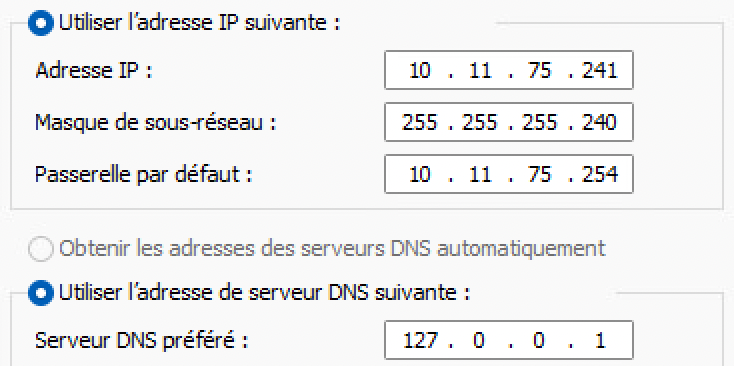

#### Installation des Rôles (AD DS + DNS)

Via le Gestionnaire de Serveur (Server Manager > Add Roles and Features), les rôles suivants ont été installés :

- **Services de domaine Active Directory (AD DS)** : Fournit la base de données d'annuaire (NTDS.dit) pour le stockage des objets (utilisateurs, ordinateurs, groupes, OU).
- **Serveur DNS** : Indispensable au fonctionnement d'AD DS, car Active Directory repose sur les enregistrements SRV du DNS pour la localisation des contrôleurs de domaine par les clients.

#### Promotion en Contrôleur de Domaine

Après l'installation des binaires, la promotion du serveur a été lancée via l'assistant de configuration (dcpromo) :

|         Paramètre          | Valeur                           |
|:------------------------------:|--------------------------------------|
|      Type de déploiement       | Ajout d’une nouvelle forêt           |
|  Nom de domaine racine (FQDN)  | galaxynl.lan                         |
|          Nom NetBIOS           | GALAXYNL                             |
| Niveau fonctionnel de la forêt | Windows Server 2025                  |
| Niveau fonctionnel du domaine  | Windows Server 2025                  |
|     Catalogue Global (GC)      | Oui (automatique pour le premier DC) |
|          Serveur DNS           | Oui (installé automatiquement)       |
|       Mot de passe DSRM        | ********                             |

Après le redémarrage, RIGEL est opérationnel en tant que premier contrôleur de domaine de la forêt galaxynl.lan.

### Architecture de l'Annuaire (OU, Groupes, Utilisateurs)

Afin d'organiser logiquement les objets du domaine et de préparer l'application ciblée des futures GPO, une structure d'Unités d'Organisation (OU) a été créée dans la racine du domaine galaxynl.lan.

**Arborescence déployée :**

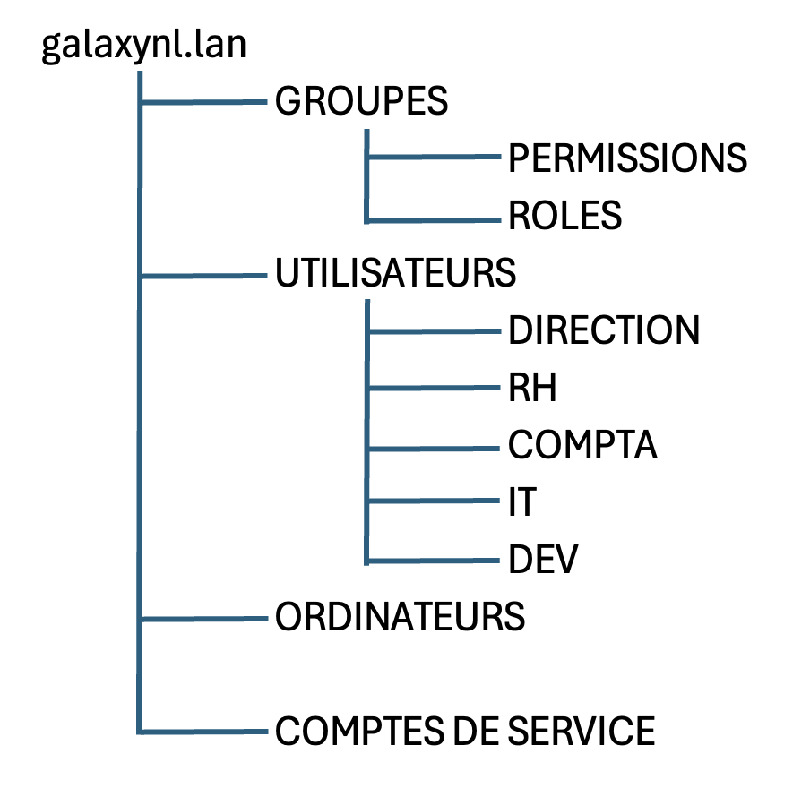

**Convention de nommage :**

- Les groupes de sécurité sont préfixés "GS_" (Groupe de Sécurité) pour les distinguer des groupes de distribution.
- Les sous-OU Utilisateurs correspondent aux VLANs métier, facilitant l'application ciblée des GPO.
- L'OU Ordinateurs accueillera les comptes machines après la jonction des postes au domaine.

Des comptes utilisateurs de test ont été créés dans chaque OU pour valider le bon fonctionnement de l'authentification et des droits d'accès.

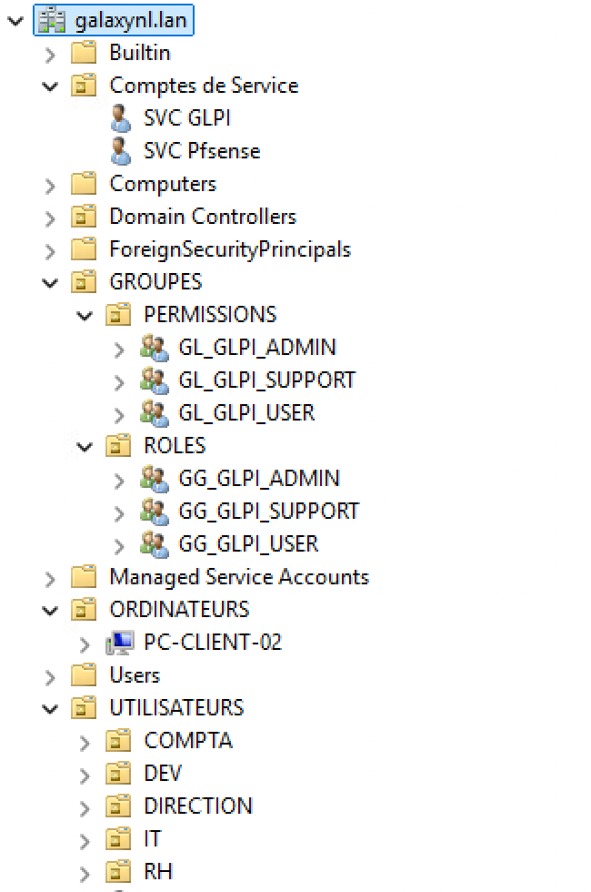

### Configuration du Service DNS et Redirecteurs

Le rôle DNS installé sur RIGEL gère automatiquement la zone de recherche directe galaxynl.lan, alimentée par les enregistrements SRV nécessaires au fonctionnement d'Active Directory. Cependant, pour que les clients du domaine puissent également résoudre les noms de domaines publics (navigation web, mises à jour), des redirecteurs DNS doivent être configurés.

**Configuration des redirecteurs :**

- Accès : DNS Manager > Propriétés du serveur > Onglet "Redirecteurs"
- Redirecteur 1 : 8.8.8.8 (Google Public DNS)
- Redirecteur 2 : 1.1.1.1 (Cloudflare DNS)

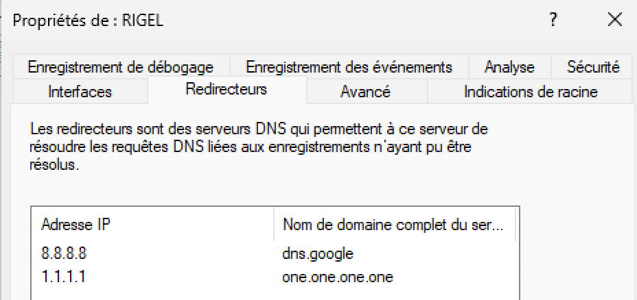

**Validation :** Test de résolution d'un nom externe depuis RIGEL :

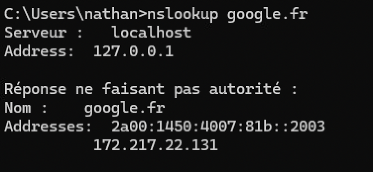

### Déploiement du Contrôleur Secondaire VEGA

#### Préparation et Adressage

Le serveur VEGA est positionné sur le segment LAN Natif du Bâtiment 2. Son rôle est d'assurer la redondance du service d'annuaire : en cas de panne du tunnel VPN ou de défaillance de RIGEL, les clients du Bâtiment 2 pourront toujours s'authentifier localement.

**Configuration réseau :**

- Adresse IPv4 : 10.11.76.241
- Masque : /28
- Passerelle : 10.11.76.254 (Interface LAN de LYRA)
- DNS Préféré : 10.11.75.241 (RIGEL — nécessaire pour joindre le domaine existant)
- DNS Secondaire : 127.0.0.1 (sera utilisé après la promotion)

**Prérequis :**

- Le tunnel IPsec entre ORION et LYRA doit être établi et fonctionnel.
- VEGA doit pouvoir résoudre galaxynl.lan via RIGEL (test : `nslookup galaxynl.lan 10.11.75.241`).

#### Jonction au Domaine et Promotion (Réplication)

**Étape 1 : Jonction au domaine :** VEGA a d'abord été joint au domaine galaxynl.lan en tant que serveur membre, via les propriétés système. Cette étape valide la connectivité réseau, la résolution DNS et l'authentification Kerberos à travers le tunnel IPsec.

**Étape 2 : Installation des rôles et promotion :** Les rôles AD DS et DNS ont été installés, puis la promotion a été lancée avec les paramètres suivants :

| Paramètre | Valeur |
|:------------------:|--------------------------------------------|
| Type de déploiement | Ajouter un contrôleur de domaine à un domaine existant |
| Domaine | galaxynl.lan |
| Catalogue Global (GC) | Oui |
| Serveur DNS | Oui |
| Site AD | Default-First-Site-Name |
| Source de réplication | RIGEL.galaxynl.lan |

Après redémarrage, VEGA réplique automatiquement l'intégralité de la base NTDS depuis RIGEL. La réplication peut être vérifiée via la commande `repadmin /replsummary`.

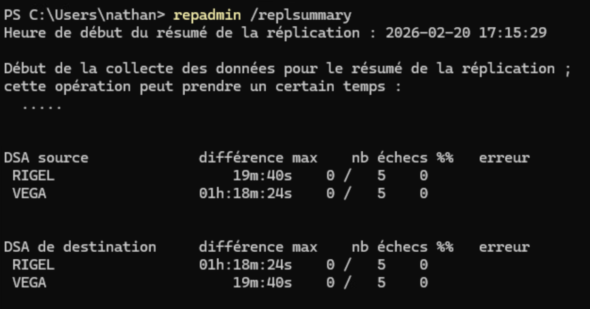

### Basculement DNS des Clients (DHCP)

Maintenant que les deux contrôleurs de domaine sont opérationnels et hébergent le rôle DNS, il est essentiel de mettre à jour la configuration DHCP pour que les clients reçoivent les bons serveurs DNS :

**Sur ORION (Bâtiment 1), pour chaque étendue DHCP :**

- DNS Server 1 : 10.11.75.241 (RIGEL)
- DNS Server 2 : 10.11.76.241 (VEGA via le tunnel IPsec, en secours)

**Sur LYRA (Bâtiment 2), pour chaque étendue DHCP :**

- DNS Server 1 : 10.11.76.241 (VEGA : résolution locale)
- DNS Server 2 : 10.11.75.241 (RIGEL via le tunnel IPsec, en secours)

Cette configuration garantit que les clients utilisent toujours le DNS le plus proche en priorité, tout en disposant d'un secours sur le site distant.

### Jonction des Postes Clients au Domaine

Les postes PC-CLIENT-01 (Bâtiment 1) et PC-CLIENT-02 (Bâtiment 2) ont été joints au domaine galaxynl.lan via les propriétés système (Paramètres > Système > À propos > Rejoindre un domaine).

**Validation :**

- Authentification avec un compte de domaine : réussie sur les deux postes.
- Le compte machine apparaît dans l'OU Ordinateurs de l'annuaire AD.
- La commande `gpresult /r` confirme l'application des stratégies de domaine.

## Services de Fichiers et Réplication Inter-Sites

### Étude du Besoin

Les collaborateurs d'ORION CONSULTING GROUP ont besoin d'un espace de stockage centralisé, organisé par service, avec des droits d'accès différenciés. Par ailleurs, les utilisateurs du Bâtiment 2 doivent accéder à ces fichiers avec des performances acceptables et sans interruption en cas de panne du site principal.

Ces deux exigences (performance locale et continuité d'activité) justifient la mise en place d'une solution combinant un espace de nommage unifié et une réplication inter-sites.

**Solution retenue :** DFS Namespaces + DFS Replication sur RIGEL et VEGA.

- **DFS Namespaces** fournit un chemin d'accès unique basé sur le domaine (`\\galaxynl.lan\Partages`), indépendant du serveur physique. Les utilisateurs n'ont pas besoin de savoir si leurs fichiers se trouvent sur RIGEL ou VEGA.
- DFS Replication synchronise automatiquement le contenu des dossiers partagés entre les deux serveurs à travers le tunnel IPsec.

Cette combinaison offre une haute disponibilité transparente : si RIGEL devient indisponible, le namespace redirige automatiquement les utilisateurs vers VEGA, sans intervention manuelle ni modification des lecteurs réseau mappés.

### Installation des Rôles

Les rôles suivants ont été installés sur RIGEL et VEGA via le Gestionnaire de Serveur (Add Roles and Features > File and Storage Services > File and iSCSI Services) :

| Rôle | RIGEL | VEGA | Description |
|:----------------:|----------|----------|----------------------------------|
| File Server | ✅ | ✅ | Rôle de base pour le partage SMB (activé par défaut) |
| DFS Namespaces | ✅ | ✅ | Espace de nommage unifié basé sur le domaine |
| DFS Replication | ✅ | ✅ | Réplication des dossiers entre les deux serveurs |

### Création de l'Arborescence de Partages

Les machines ne disposant que d'un seul disque (C:), l'arborescence de partages est créée directement sur la partition système.

**Sur RIGEL et VEGA (structure identique) :**

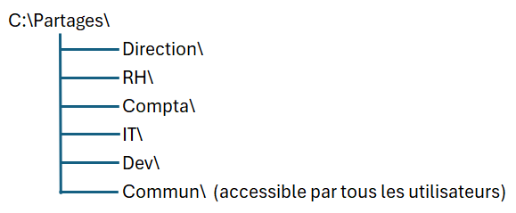

En environnement de production, ces dossiers seraient placés sur un disque dédié aux données (D:) pour séparer le système de l'espace de stockage, faciliter les sauvegardes et éviter qu'un remplissage du volume de données n'impacte le fonctionnement de l'OS.

### Stratégie de Gestion des Droits (AGDLP)

La gestion des permissions suit la méthode AGDLP recommandée par Microsoft. Cette méthodologie structure l'attribution des droits en quatre niveaux :

**A**ccount → **G**lobal Group → **D**omain **L**ocal Group → **P**ermission

Le principe est le suivant :

- Les comptes utilisateurs sont membres d'un **Groupe Global** (GG_), qui représente leur fonction dans l'entreprise.
- Les **Groupes Domaine Locaux** (GL_) sont créés pour chaque ressource et portent les permissions NTFS.
- Les Groupes Globaux sont imbriqués dans les Groupes Domaine Locaux.

Cette séparation offre deux avantages majeurs : si un nouveau service est créé, il suffit d'ajouter le Groupe Global correspondant dans le Groupe Domaine Local de la ressource, sans toucher aux permissions NTFS. Inversement, si un collaborateur change de service, il suffit de modifier son appartenance au Groupe Global.

**Architecture des groupes déployée :**

| Groupe Domaine Local (GL_) | Appliqué sur | Permission NTFS |
|:-------------------------:|-------------------------|--------------------|
| GL_Direction | C:\\Partages\\Direction | Modification |
| GL_RH | C:\\Partages\\RH | Modification |
| GL_Compta | C:\\Partages\\Compta | Modification |
| GL_IT | C:\\Partages\\IT | Contrôle Total |
| GL_Dev | C:\\Partages\\Dev | Modification |

| Groupe Global (GG_) | Contenu | Membre de |
|:----------------------:|-----------------------------|-------------------|
| GG_Direction | Utilisateurs de la Direction | GL_Direction |
| GG_RH | Utilisateurs des Ressources Humaines | GL_RH |
| GG_Compta | Utilisateurs de la Comptabilité | GL_Compta |
| GG_IT | Utilisateurs du service Informatique | GL_IT |
| GG_Dev | Utilisateurs du pôle Développement | GL_Dev |

Le dossier Commun est accessible par tous les utilisateurs du domaine (Utilisateurs du domaine en Lecture / Écriture).

Schéma de la chaine AGDLP (exemple pour le service IT) :

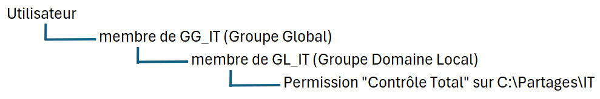

### Permissions NTFS et Droits de Partage

**Permissions de partage (SMB) :** "Authenticated Users" en "Full Control" sur chaque partage. Le contrôle d'accès effectif est délégué aux permissions NTFS via les groupes GL_.

**Permissions NTFS appliquées :**

| Dossier | Groupe autorisé     | Permission     | Héritage |
|:-----------:|-------------------------|--------------------|--------------|
|  Direction  | GL_Direction            | Modification       | Désactivé    |
|     RH      | GL_RH                   | Modification       | Désactivé    |
|   Compta    | GL_Compta               | Modification       | Désactivé    |
|     IT      | GL_IT                   | Contrôle Total     | Désactivé    |
|     Dev     | GL_Dev                  | Modification       | Désactivé    |
|   Commun    | Utilisateurs du domaine | Lecture / Ecriture | Désactivé    |

L'héritage a été désactivé sur chaque dossier pour garantir l'étanchéité des droits. Seul le groupe GL_IT dispose du Contrôle Total, lui permettant de gérer les permissions et de dépanner en cas de problème d'accès.

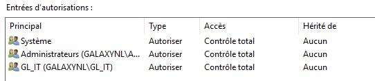

### Configuration de l'Espace de Noms DFS (Namespaces)

L'espace de noms DFS a été créé depuis la console DFS Management sur RIGEL (Tools > DFS Management).

**Création du namespace :**

|      Paramètre       | Valeur                 |
|:------------------------:|----------------------------|
|           Type           | Domain-based namespace     |
|           Nom            | Partages                   |
| Chemin d’accès résultant | `\\galaxynl.lan\Partages` |
|  Serveurs de namespace   | RIGEL et VEGA              |

**Ajout des dossiers dans le namespace :**

Pour chaque dossier partagé, un "folder" DFS a été créé dans le namespace avec deux "folder targets" (un sur chaque serveur) :

| Dossier DFS | Target RIGEL | Target VEGA |
|:-------------------------:|----------------|---------------|
| `\\galaxynl.lan\Partages\Direction` | `\\RIGEL\Direction` | `\\VEGA\Direction` |
| `\\galaxynl.lan\Partages\RH` | `\\RIGEL\RH` | `\\VEGA\RH` |
| `\\galaxynl.lan\Partages\Compta` | `\\RIGEL\Compta` | `\\VEGA\Compta` |
| `\\galaxynl.lan\Partages\IT` | `\\RIGEL\IT` | `\\VEGA\IT` |
| `\\galaxynl.lan\Partages\Dev` | `\\RIGEL\Dev` | `\\VEGA\Dev` |
| `\\galaxynl.lan\Partages\Commun` | `\\RIGEL\Commun` | `\\VEGA\Commun` |

Le client DFS intégré à Windows sélectionne automatiquement le serveur le plus proche (même site AD), garantissant des performances optimales pour les utilisateurs des deux bâtiments.

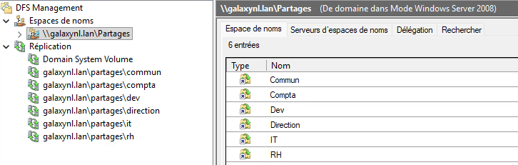

### Configuration de la Réplication DFS-R

Lors de l'ajout des folder targets, l'assistant DFS Management propose automatiquement de configurer la réplication. Elle a été activée pour chaque dossier.

**Paramètres du groupe de réplication :**

|   Paramètre    | Valeur                                     |
|:------------------:|------------------------------------------------|
|     Topologie      | Full Mesh                                      |
|  Membre principal  | RIGEL (sauf pour Dev)                          |
|   Planification    | Réplication continue (bande passante complète) |
| Filtre de fichiers | Aucun                                          |

Lorsqu'un utilisateur du Bâtiment 1 crée ou modifie un fichier via `\\galaxynl.lan\Partages\IT` (servi par RIGEL), DFS-R détecte le changement et réplique automatiquement vers VEGA à travers le tunnel IPsec. L'inverse fonctionne de la même façon.

**Vérification :**

```powershell
dfsrdiag pollad
Get-DfsrBacklog -GroupName "galaxynl.lan\Partages\IT" -SourceComputerName RIGEL -DestinationComputerName VEGA
```

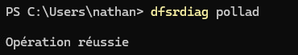

### Mappage des Lecteurs Réseau par GPO

Pour simplifier l'accès, des lecteurs réseau sont mappés automatiquement à l'ouverture de session via une stratégie de groupe.

- **GPO créée :** MAP_Lecteurs_Reseau
- **Liaison :** OU Utilisateurs
- **Chemin :** User Configuration > Preferences > Windows Settings > Drive Maps

| Lettre | Chemin DFS | Ciblage | Description |
|:------:|-------------------------|---------------------|--------------|
| P : | `\\galaxynl.lan\Partages\Commun` | Aucun (tous les utilisateurs) | Partage commun |
| S : | `\\galaxynl.lan\Partages\Direction` | Membres de GG_Direction | Partage Direction |
| S : | `\\galaxynl.lan\Partages\RH` | Membres de GG_RH | Partage RH |
| S : | `\\galaxynl.lan\Partages\Compta` | Membres de GG_Compta | Partage Compta |
| S : | `\\galaxynl.lan\Partages\IT` | Membres de GG_IT | Partage IT |
| S : | `\\galaxynl.lan\Partages\Dev` | Membres de GG_Dev | Partage Dev |

Le lecteur P: (Public) est commun à tous. Le lecteur S: (Service) est mappé conditionnellement selon l'appartenance au Groupe Global, grâce à l'Item-Level Targeting. Chaque utilisateur ne voit que le partage de son propre service.

Les chemins DFS (`\\galaxynl.lan\...`) garantissent que le mappage fonctionne quel que soit le site, sans référence directe à RIGEL ou VEGA.

> [!NOTE]
> Le ciblage s'effectue sur les Groupes Globaux (GG_) et non sur les Groupes Domaine Locaux (GL_), car les GG_ représentent l'appartenance fonctionnelle de l'utilisateur, tandis que les GL_ sont liés aux ressources.

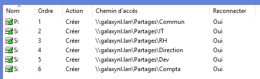

### Tests et Validation

#### Tests fonctionnels

| Test | Depuis | Action | Résultat | Statut |
|:---------:|------------|------------------------|-------------------|--------|
| Accès via DFS | PC-CLIENT-01 | Ouvrir `\\galaxynl.lan\Partages` | Arborescence visible | ✅ |
| Lecteur S: mappé | PC-CLIENT-01 (compte GG_Direction) | Ouverture de session | S: pointe vers `\Direction` | ✅ |
| Lecteur P: mappé | PC-CLIENT-01 | Ouverture de session | P: pointe vers `\Commun` | ✅ |
| Isolation AGDLP | PC-CLIENT-01 (compte GG_IT) | Accéder à `\\galaxynl.lan\Partages\Direction` | Accès refusé (pas membre de GL_Direction) | ✅ |
| Accès depuis Bât. 2 | PC-CLIENT-02 (compte GG_Dev) | Ouvrir S: | Servi par VEGA (local) | ✅ |

#### Tests de réplication

| Test | Action | Résultat attendu | Statut |
|:-------------:|-------------------------------|-------------------|--------|
| Réplication Bât. 1 vers Bât. 2 | Créer un fichier sur RIGEL via PC-CLIENT-01 | Fichier visible sur VEGA | ✅ |
| Réplication Bât. 2 vers Bât. 1 | Créer un fichier sur VEGA via PC-CLIENT-02 | Fichier visible sur RIGEL | ✅ |
| Backlog | `Get-DfsrBacklog` | Backlog à 0 | ✅ |

#### Test de haute disponibilité

| Test | Action | Résultat attendu | Statut |
|:-------------:|-------------------|-------------------------------|--------|
| Coupure de RIGEL | Arrêt de la VM RIGEL | PC-CLIENT-01 accède toujours à `\\galaxynl.lan\Partages` via VEGA (bascule après ~30s) | ✅ |
| Remise en service | Redémarrage de RIGEL | DFS-R rattrape le retard automatiquement | ✅ |

Le temps de bascule (~30 secondes) correspond au cache du client DFS Windows. En production, ce délai peut être réduit via la clé de registre DfsDcNameDelay.

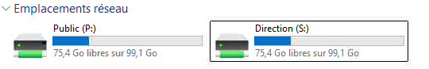

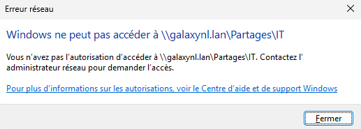

## Politique de Filtrage Avancée (Firewalling)

### Stratégie de Filtrage

Maintenant que tous les services sont déployés et opérationnels, la politique de filtrage initiale (Any/Any) utilisée lors de la phase de mise en service est remplacée par une politique restrictive suivant le principe du moindre privilège : seuls les flux strictement nécessaires au fonctionnement des services sont autorisés, tout le reste est bloqué par la règle implicite "Deny All" de pfSense.

La stratégie de filtrage repose sur trois principes :

1. **Moindre privilège** : Chaque VLAN n'accède qu'aux services dont ses utilisateurs ont besoin. Le service Comptabilité n'a aucune raison d'atteindre l'interface Zabbix, seul le service IT y accède.
2. **Isolation du WiFi** : Le VLAN WiFi (invités, BYOD) est totalement isolé du réseau interne. Il ne peut accéder qu'à Internet.
3. **Isolation de la DMZ** : Le serveur web MEISSA ne peut en aucun cas initier une connexion vers le réseau interne.

**Note sur la syntaxe pfSense :** Les règles utilisent les étiquettes natives de pfSense (ex : "VLAN40_IT subnets") et les alias personnalisés définis en section 9.2. Cette approche permet de condenser plusieurs règles en une seule et facilite la maintenance : modifier l'IP d'un serveur ne nécessite que la mise à jour de l'alias, sans toucher aux règles.

### Alias pfSense

Avant de créer les règles, des alias ont été définis dans Firewall > Aliases pour simplifier la gestion et la lisibilité des règles.

#### Alias de type Host

| Alias | Valeur | Description |
|:------------:|--------------------------|------------------------------|
| RIGEL | 10.11.75.241 | DC principal / Serveur de fichiers |
| BELLATRIX | 10.11.75.242 | GLPI / Portail admin |
| MEISSA | 10.11.75.1 | Serveur web DMZ |
| VEGA | 10.11.76.241 | DC secondaire / Réplication fichiers |
| SULAFAT | 10.11.76.242 | Serveur Zabbix |
| ORION_MGMT | 10.11.75.254 | Interface LAN d'ORION |
| LYRA_MGMT | 10.11.76.254 | Interface LAN de LYRA |
| Serveurs_Linux | 10.11.75.242, 10.11.75.1, 10.11.76.242 | BELLATRIX, MEISSA, SULAFAT |
| Serveurs_Windows | 10.11.75.241, 10.11.76.241 | RIGEL, VEGA |
| Firewalls | 10.11.75.254, 10.11.76.254 | ORION et LYRA |

#### Alias de type Network

| Alias | Valeur | Description |
|:------------:|--------------------------|------------------------------|
| RFC1918 | 10.0.0.0/8, 172.16.0.0/12, 192.168.0.0/16 | Réseaux privés (blocage WiFi/DMZ) |
| LAN_BAT1 | 10.11.75.240/28 | Sous-réseau serveurs Bâtiment 1 |
| LAN_BAT2 | 10.11.76.240/28 | Sous-réseau serveurs Bâtiment 2 |

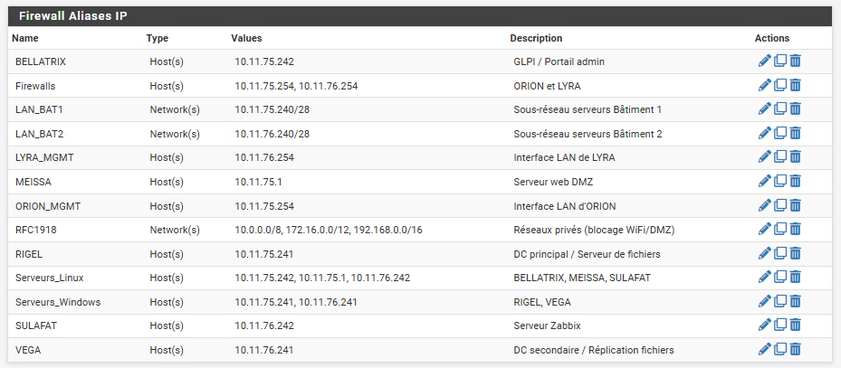

#### Alias de type Port

| Alias | Valeur | Description |
|:------------:|--------------------------|------------------------------|
| Ports_AD | 53, 88, 389, 445, 464, 636 | DNS, Kerberos, LDAP/S, SMB, chgt mdp |
| Ports_Web | 80, 443 | HTTP et HTTPS |
| Ports_Zabbix | 10050, 10051 | Zabbix polling + trapping |
| Ports_GLPI | 80, 443, 8080 | HTTP, HTTPS et GLPI |

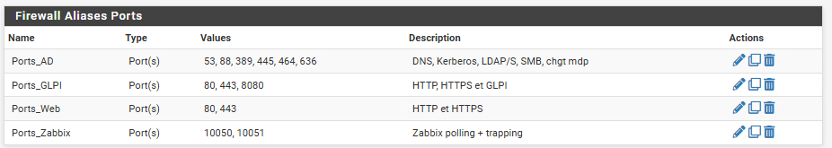

### Règles Détaillées - Pare-feu ORION

#### Interface VLANs métier (VLAN10_DIRECTION, VLAN20_DRH, VLAN30_COMPTA)

Les trois interfaces partagent le même jeu de règles.

| # | Action | Protocole | Source | Destination | Port Dst | Description |
|:---:|--------|-------------|----------------|----------------|---------------|----------------|
| 1 | Pass | TCP/UDP | VLAN subnets | Alias RIGEL | Alias Ports_AD | Services AD |
| 2 | Pass | TCP | VLAN subnets | Alias BELLATRIX | Alias Ports_GLPI | Agent GLPI |
| 3 | Pass | TCP | VLAN subnets | Alias SULAFAT | Alias Ports_Zabbix | Agent Zabbix |
| 4 | Pass | TCP | VLAN subnets | Any | Alias Ports_Web | Navigation web + mises à jour |
| 5 | Pass | ICMP | VLAN subnets | Any | * | Ping |
| – | Block | Any | Any | Any | * | Deny All (implicite) |

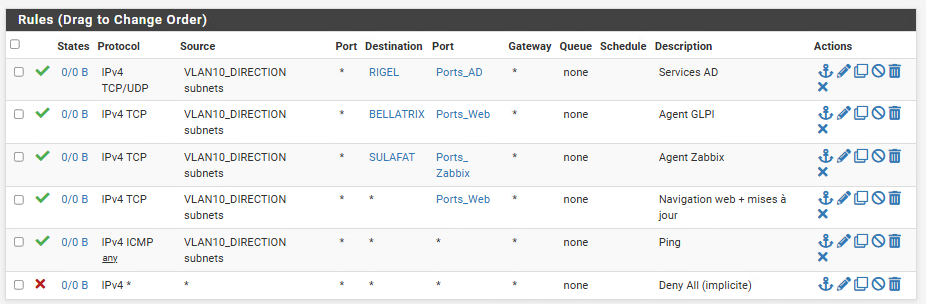

#### Interface VLAN40_IT

| # | Action | Protocole | Source | Destination | Port Dst | Description |
|:---:|--------|-------------|----------------|----------------|---------------|----------------|
| 1 | Pass | TCP/UDP | VLAN40_IT subnets | Alias RIGEL | Alias Ports_AD | Services AD |
| 2 | Pass | TCP | VLAN40_IT subnets | Alias SULAFAT | Alias Ports_Zabbix | Agent Zabbix |
| 3 | Pass | TCP | VLAN40_IT subnets | Alias SULAFAT | Alias Ports_Web | Interface Zabbix |
| 4 | Pass | TCP | VLAN40_IT subnets | Alias BELLATRIX | Alias Ports_GLPI | Agent GLPI |
| 5 | Pass | TCP | VLAN40_IT subnets | Alias Firewalls | 443 | Admin pfSense |
| 6 | Pass | TCP | VLAN40_IT subnets | Alias Serveurs_Linux | 22 | SSH |
| 7 | Pass | TCP | VLAN40_IT subnets | Alias Serveurs_Windows | 3389 | RDP |
| 8 | Pass | TCP | VLAN40_IT subnets | Any | Alias Ports_Web | Navigation web |
| 9 | Pass | ICMP | VLAN40_IT subnets | Any | * | Ping |
| – | Block | Any | Any | Any | * | Deny All (implicite) |

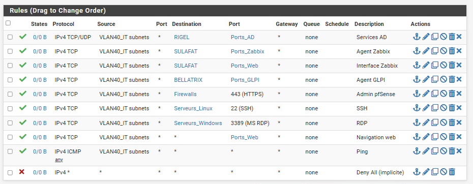

#### Interface VLAN50_WIFI

| # | Action | Protocole | Source | Destination | Port Dst | Description |
|:---:|--------|-------------|----------------|----------------|---------------|----------------|
| 1 | Block | Any | VLAN50_WIFI subnets | Alias RFC1918 | * | Bloquer tout accès réseau privé |
| 2 | Pass | TCP/UDP | VLAN50_WIFI subnets | Any | 53 | DNS public |
| 3 | Pass | TCP | VLAN50_WIFI subnets | Any | Alias Ports_Web | Navigation web |
| – | Block | Any | Any | Any | * | Deny All (implicite) |


#### Interface DMZ

| # | Action | Protocole | Source | Destination | Port Dst | Description |
|:---:|--------|-------------|----------------|----------------|---------------|----------------|
| 1 | Pass | TCP | DMZ subnets | Alias BELLATRIX | Alias Ports_GLPI | Agent GLPI |
| 2 | Pass | TCP | DMZ subnets | Alias SULAFAT | Alias Ports_Zabbix | Agent Zabbix |
| 3 | Block | Any | DMZ subnets | Alias RFC1918 | * | Bloquer DMZ vers tout réseau privé |
| 4 | Pass | TCP | DMZ subnets | Any | Alias Ports_Web | Mises à jour système |
| – | Block | Any | Any | Any | * | Deny All (implicite) |

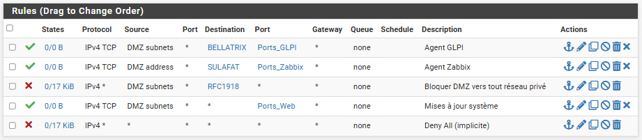

#### Interface LAN (segment serveurs)

| # | Action | Protocole | Source | Destination | Port Dst | Description |
|:---:|--------|-------------|----------------|----------------|---------------|----------------|
| 1 | Pass | TCP | LAN subnets | Alias VEGA | * | Réplication AD + DFS-R |
| 2 | Pass | TCP | LAN subnets | Alias SULAFAT | Alias Ports_Zabbix | Agents Zabbix vers SULAFAT |
| 3 | Pass | UDP | LAN address | Alias SULAFAT | 161 | SNMP polling vers SULAFAT |
| 4 | Pass | TCP | LAN subnets | Any | Alias Ports_Web | Mises à jour + navigation |
| 5 | Pass | TCP/UDP | LAN subnets | Any | 53 | DNS (redirecteurs) |
| 6 | Pass | ICMP | LAN subnets | Any | * | Ping |
| – | Block | Any | Any | Any | * | Deny All (implicite) |

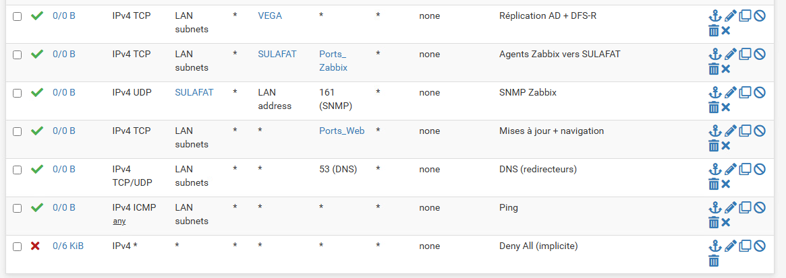

#### Interface IPsec

| # | Action | Protocole | Source | Destination | Port Dst | Description |
|:---:|--------|-------------|----------------|----------------|---------------|----------------|
| 1 | Pass | TCP | Alias VEGA | Alias RIGEL | * | Réplication AD + DFS-R |
| 2 | Pass | TCP | Alias SULAFAT | Alias LAN_BAT1 | 10050 | Zabbix polling vers Bât. 1 |
| 3 | Pass | TCP | Alias SULAFAT | Alias MEISSA | 10050 | Zabbix polling vers DMZ |
| 4 | Pass | UDP | Alias SULAFAT | LAN Address | 161 | SNMP polling vers ORION |
| 5 | Pass | TCP | Alias LAN_BAT2 | Alias BELLATRIX | Alias Ports_GLPI | Agent GLPI Bât. 2 |
| 6 | Pass | ICMP | 10.11.76.0/24 | 10.11.75.0/24 | * | Diagnostic inter-sites |
| – | Block | Any | Any | Any | * | Deny All (implicite) |

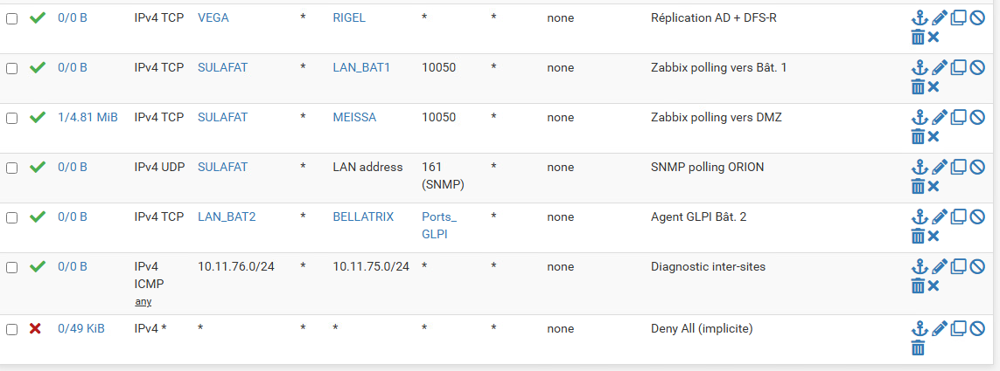

### Règles Détaillées - Pare-feu LYRA

#### Interface VLAN40_IT (Bâtiment 2)

| # | Action | Protocole | Source | Destination | Port Dst | Description |
|:---:|--------|-------------|----------------|----------------|---------------|----------------|
| 1 | Pass | TCP/UDP | VLAN40_IT subnets | Alias VEGA | Alias Ports_AD | Services AD |
| 2 | Pass | TCP | VLAN40_IT subnets | Alias SULAFAT | Alias Ports_Zabbix | Agent Zabbix |
| 3 | Pass | TCP | VLAN40_IT subnets | Alias SULAFAT | Alias Ports_Web | Interface Zabbix |
| 4 | Pass | TCP | VLAN40_IT subnets | Alias BELLATRIX | Alias Ports_GLPI | Agent GLPI |
| 5 | Pass | TCP | VLAN40_IT subnets | Alias Firewalls | 443 | Admin pfSense |
| 6 | Pass | TCP | VLAN40_IT subnets | Alias Serveurs_Linux | 22 | SSH |
| 7 | Pass | TCP | VLAN40_IT subnets | Alias Serveurs_Windows | 3389 | RDP |
| 8 | Pass | TCP | VLAN40_IT subnets | Any | Alias Ports_Web | Navigation web |
| 9 | Pass | ICMP | VLAN40_IT subnets | Any | * | Ping |
| – | Block | Any | Any | Any | * | Deny All (implicite) |

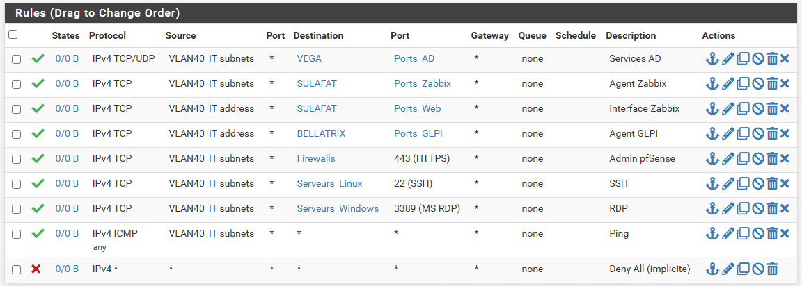

#### Interface VLAN50_WIFI (Bâtiment 2)

| # | Action | Protocole | Source | Destination | Port Dst | Description |
|:---:|--------|-------------|----------------|----------------|---------------|----------------|
| 1 | Block | Any | VLAN50_WIFI subnets | Alias RFC1918 | * | Bloquer tout accès réseau privé |
| 2 | Pass | TCP/UDP | VLAN50_WIFI subnets | Any | 53 | DNS public |
| 3 | Pass | TCP | VLAN50_WIFI subnets | Any | Alias Ports_Web | Navigation web |
| – | Block | Any | Any | Any | * | Deny All (implicite) |

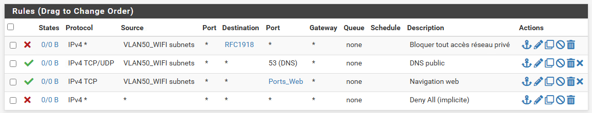

#### Interface VLAN60_DEV

| # | Action | Protocole | Source | Destination | Port Dst | Description |
|:---:|--------|-------------|----------------|----------------|---------------|----------------|
| 1 | Pass | TCP/UDP | VLAN60_DEV subnets | Alias VEGA | Alias Ports_AD | Services AD |
| 2 | Pass | TCP | VLAN60_DEV subnets | Alias SULAFAT | Alias Ports_Zabbix | Agent Zabbix |
| 3 | Pass | TCP | VLAN60_DEV subnets | Alias BELLATRIX | Alias Ports_GLPI | Agent GLPI |
| 4 | Pass | TCP | VLAN60_DEV subnets | Any | Alias Ports_Web | Navigation web |
| 5 | Pass | ICMP | VLAN60_DEV subnets | Any | * | Ping |
| – | Block | Any | Any | Any | * | Deny All (implicite) |

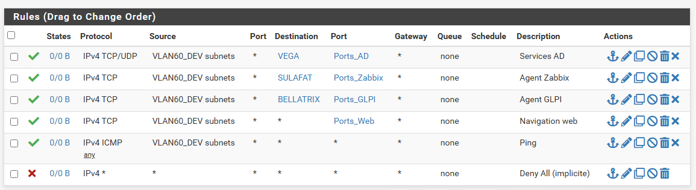

#### Interface LAN (segment serveurs Bâtiment 2)

| # | Action | Protocole | Source | Destination | Port Dst | Description |
|:---:|--------|-------------|----------------|----------------|---------------|----------------|
| 1 | Pass | TCP | LAN subnets | Alias RIGEL | * | Réplication AD + DFS-R |
| 2 | Pass | TCP | LAN subnets | Alias BELLATRIX | Alias Ports_GLPI | Agents GLPI vers BELLATRIX |
| 3 | Pass | UDP | Alias SULAFAT | LAN Address | 161 | SNMP polling vers LYRA |
| 4 | Pass | TCP | LAN subnets | Any | Alias Ports_Web | Mises à jour + navigation |
| 5 | Pass | TCP/UDP | LAN subnets | Any | 53 | DNS (redirecteurs) |
| 6 | Pass | ICMP | LAN subnets | Any | * | Ping |
| – | Block | Any | Any | Any | * | Deny All (implicite) |

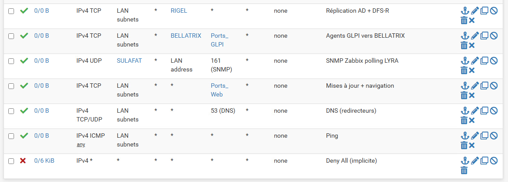

#### Interface IPsec

| # | Action | Protocole | Source | Destination | Port Dst | Description |
|:---:|--------|-------------|----------------|----------------|---------------|----------------|
| 1 | Pass | TCP | Alias RIGEL | Alias VEGA | * | Réplication AD + DFS-R |
| 2 | Pass | TCP | Alias BELLATRIX | Alias VEGA | 636 | LDAPS GLPI (fallback) |
| 3 | Pass | TCP | Alias RIGEL | Alias SULAFAT | 22 | SSH administration |
| 4 | Pass | TCP | Alias LAN_BAT1 | Alias SULAFAT | Alias Ports_Zabbix | Zabbix agents Bât. 1 |
| 5 | Pass | ICMP | 10.11.75.0/24 | 10.11.76.0/24 | * | Diagnostic inter-sites |
| – | Block | Any | Any | Any | * | Deny All (implicite) |

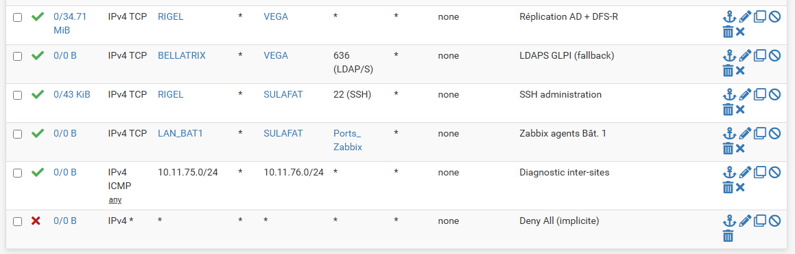

### Tests de Validation des Règles

#### Tests d'accès autorisés

| Test | Depuis | Vers | Statut |
|:---------------:|---------------------|--------------------|----------|
| Accès DFS | PC-CLIENT-01 (VLAN40_IT) | `\\galaxynl.lan\Partages\IT` | ☐ |
| GLPI depuis IT | PC-CLIENT-01 (VLAN40_IT) | http://BELLATRIX:8080 | ☐ |
| Zabbix depuis IT | PC-CLIENT-01 (VLAN40_IT) | http://SULAFAT/zabbix | ☐ |
| SSH depuis IT | PC-CLIENT-01 (VLAN40_IT) | `ssh BELLATRIX` | ☐ |
| RDP depuis IT | PC-CLIENT-01 (VLAN40_IT) | `rdp RIGEL` | ☐ |
| Navigation web (Compta) | Poste VLAN30_COMPTA | https://google.fr | ☐ |
| WiFi vers Internet | Poste VLAN50_WIFI | https://google.fr | ☐ |
| Site vitrine WAN | Machine externe | http://10.10.101.75 | ☐ |

#### Tests d'accès bloqués

| Test | Depuis | Vers | Statut |
|:---------------:|------------------|---------------------|------------|
| GLPI depuis Compta | Poste VLAN30_COMPTA | http://BELLATRIX:8080 | ☐ Bloqué |
| Zabbix depuis DRH | Poste VLAN20_DRH | http://SULAFAT/zabbix | ☐ Bloqué |
| SSH depuis Compta | Poste VLAN30_COMPTA | `ssh BELLATRIX` | ☐ Bloqué |
| RDP depuis DRH | Poste VLAN20_DRH | `rdp RIGEL` | ☐ Bloqué |
| WiFi vers LAN | Poste VLAN50_WIFI | `ping RIGEL` | ☐ Bloqué |
| DMZ vers LAN | MEISSA | `ping RIGEL` | ✅ Bloqué |
| Isolation AGDLP | Compte GG_IT | `\\galaxynl.lan\Partages\Direction` | ✅ Refusé |

#### Tests des agents

|            Test            | Depuis | Vers  | Port  | Statut |
|:-------------------:|--------------|-----------------|------------|---------|
| Zabbix polling (local Bât. 2) | SULAFAT | VEGA | TCP 10050 | ✅ |
| Zabbix polling (via IPsec) | SULAFAT | RIGEL | TCP 10050 | ✅ |
| Zabbix polling (via IPsec) | SULAFAT | BELLATRIX | TCP 10050 | ✅ |
| GLPI inventaire (local Bât. 1) | RIGEL | BELLATRIX | TCP 80 | ✅ |
| GLPI inventaire (via IPsec) | VEGA | BELLATRIX | TCP 80 | ✅ |
| GLPI inventaire (via IPsec) | SULAFAT | BELLATRIX | TCP 80 | ✅ |

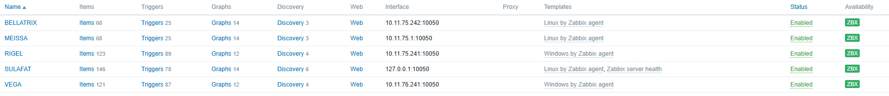

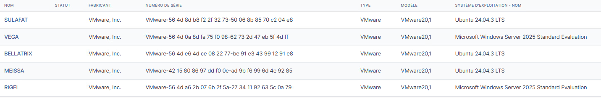

## Zone Démilitarisée - Serveur Web MEISSA

### Étude du Besoin et Positionnement en DMZ

ORION CONSULTING GROUP souhaite disposer d'un site vitrine accessible depuis l'extérieur, présentant les activités et les coordonnées du cabinet. Ce service étant exposé publiquement, il constitue une surface d'attaque potentielle et doit impérativement être isolé du réseau interne.

Le serveur MEISSA est positionné dans la zone DMZ, un segment réseau dédié disposant de sa propre interface sur le pare-feu ORION. Les règles de filtrage (détaillées en section 9.3) garantissent que MEISSA ne peut en aucun cas initier une connexion vers les VLANs internes ou le LAN Serveurs, à l'exception des flux ciblés vers BELLATRIX (agent GLPI) et SULAFAT (agent Zabbix).

**Adressage :**

- IP : 10.11.75.1
- Masque : /28
- Passerelle : 10.11.75.14 (interface DMZ d'ORION)
- DNS : 10.11.75.241 (RIGEL, pour les mises à jour système uniquement)

### Installation et Configuration de Nginx

Le choix de Nginx se justifie par les contraintes de ressources de la VM (2 vCPU, 2 Go RAM) et par la nature du contenu servi (pages statiques). Nginx est reconnu pour sa faible empreinte mémoire et ses performances supérieures à Apache pour le service de contenu statique.

Le paquet Nginx a été installé depuis les dépôts officiels Ubuntu 24.04, puis le service a été activé au démarrage.

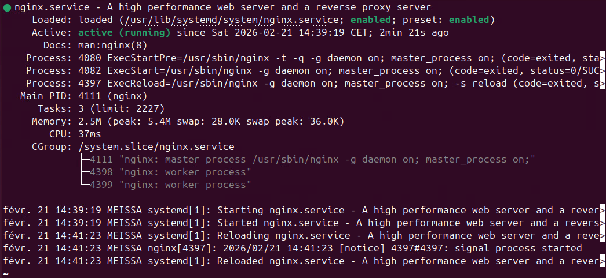

### Déploiement du Site Vitrine

Le site vitrine est constitué de fichiers HTML/CSS statiques déployés dans le répertoire `/var/www/orion-vitrine/`. La page d'accueil présente les informations de l'entreprise : nom, activité, coordonnées fictives et liens de contact.

**Structure du site :**

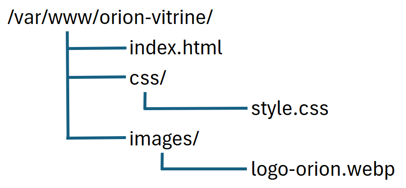

Un virtual host Nginx a été configuré dans `/etc/nginx/sites-available/orion` pour servir le site sur le port 80, avec orion-consulting.lan comme server_name. Le site par défaut de Nginx a été désactivé et remplacé par cette configuration.

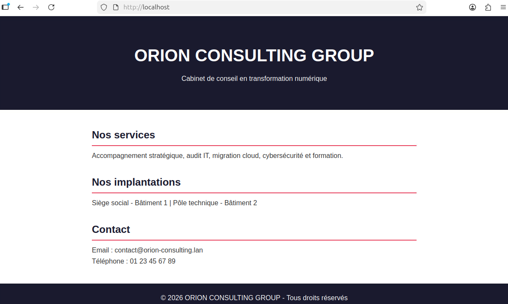

### Règles de Filtrage et NAT

Pour rendre le site vitrine accessible depuis l'extérieur, une règle de redirection de port (Port Forward) a été configurée sur ORION :

|  Paramètre  | Valeur                      |
|:---------------:|---------------------------------|
|     Chemin      | Firewall > NAT > Port Forward |
|    Interface    | WAN                             |
|    Protocole    | TCP                             |
|   Destination   | WAN Address, port 80            |
| Redirect Target | 10.11.75.1, port 80             |

Un utilisateur externe accédant à http://10.10.101.75 est automatiquement redirigé vers MEISSA. pfSense crée automatiquement la règle de filtrage associée sur l'interface WAN.

Les règles de filtrage de la DMZ (section 9.3) garantissent l'isolation : MEISSA peut répondre aux requêtes entrantes, envoyer ses inventaires vers GLPI et Zabbix, et accéder à Internet pour ses mises à jour, mais ne peut joindre aucune autre ressource interne.

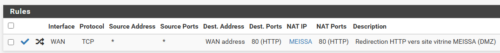

### Tests d'Accessibilité

| Test | Depuis | Commande / URL | Résultat | Statut |
|:--------------:|-----------------|-------------------|-----------|-----------|
| Accès local | MEISSA | `curl http://localhost` | Page HTML retournée | ✅ |
| Accès depuis le LAN | PC-CLIENT-01 | http://10.11.75.1 | Site vitrine affiché | ✅ |
| Accès depuis le WAN | Machine externe | http://10.10.101.75 | Site affiché via NAT | ☐ |
| DMZ vers LAN | MEISSA | `ping 10.11.75.241` | Timeout (bloqué) | ✅ |
| DMZ vers VLANs | MEISSA | `ping 10.11.75.78` | Timeout (bloqué) | ✅ |

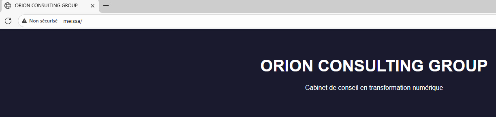

## Supervision de l'Infrastructure - SULAFAT (Zabbix)

### Étude du Besoin

Une infrastructure réseau sans supervision est une infrastructure aveugle. Le service IT d'ORION CONSULTING GROUP doit pouvoir détecter les pannes et dégradations en temps réel, surveiller les indicateurs de performance (CPU, RAM, disque, réseau) de chaque machine, recevoir des alertes en cas de dépassement de seuils critiques et disposer d'un historique pour l'analyse de tendances.

**Solution retenue :** Zabbix Server 7.0 LTS, déployé sur SULAFAT (Bâtiment 2, Ubuntu 24.04) avec une stack LAMP (Apache, MariaDB, PHP).

Le choix de positionner Zabbix sur le Bâtiment 2 est stratégique : le serveur de supervision collecte les métriques des machines du Bâtiment 1 à travers le tunnel IPsec, ce qui constitue un test permanent de la connectivité inter-sites. Toute coupure du tunnel serait immédiatement détectée par la perte de contact avec les agents du site principal.

### Installation du Serveur Zabbix

La stack LAMP (Apache, MariaDB, PHP avec les modules requis) a été installée en prérequis. Le dépôt officiel Zabbix 7.0 LTS pour Ubuntu 24.04 a ensuite été ajouté, puis les paquets zabbix-server-mysql, zabbix-frontend-php, zabbix-apache-conf et zabbix-sql-scripts ont été installés.

Une base de données dédiée a été créée dans MariaDB avec un utilisateur disposant des privilèges restreints à cette base. Le schéma initial de Zabbix a été importé depuis le script SQL fourni par le paquet.

Après configuration du fichier `/etc/zabbix/zabbix_server.conf` (paramètres de connexion à la base de données), les services ont été activés et démarrés.

L'interface web est accessible à l'adresse : http://10.11.76.242/zabbix

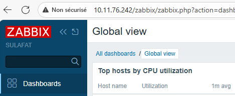

### Déploiement des Agents Zabbix

#### Méthode 1 : Installation manuelle sur les serveurs

L'agent Zabbix a été installé individuellement sur chaque serveur. Sur les machines Linux (BELLATRIX, MEISSA), le paquet zabbix-agent a été installé depuis le dépôt officiel. Sur les serveurs Windows (RIGEL, VEGA), le MSI Zabbix Agent 2 a été téléchargé et installé manuellement.

La configuration de chaque agent pointe vers SULAFAT (10.11.76.242) en tant que serveur Zabbix, avec le hostname de la machine comme identifiant.

#### Méthode 2 : Déploiement par GPO sur les postes clients

Pour les postes Windows du domaine, une stratégie de groupe automatise le déploiement. Le package MSI de Zabbix Agent 2 a été placé sur le partage `\\galaxynl.lan\Partages\IT\Deploiement\ZabbixAgent\.` Une GPO de script de démarrage (Computer Configuration > Policies > Windows Settings > Scripts > Startup) a été créée et liée à l'OU Ordinateurs. Tout nouveau poste joint au domaine reçoit automatiquement l'agent au redémarrage suivant.

**Cas particulier des pare-feux :** ORION et LYRA (pfSense) ne supportent pas l'agent Zabbix natif. La supervision est assurée via le protocole SNMP v2c, activé dans Services > SNMP sur chaque pare-feu.

**Machines supervisées :**

| Machine  | OS              | Agent            | Méthode |
|:------------:|---------------------|----------------------|-------------|
|    ORION     | pfSense             | SNMP v2c             | Manuelle    |
|     LYRA     | pfSense             | SNMP v2c             | Manuelle    |
|    RIGEL     | Windows Server 2025 | Zabbix Agent 2       | Manuelle    |
|     VEGA     | Windows Server 2025 | Zabbix Agent 2       | Manuelle    |
|    MEISSA    | Ubuntu 24.04        | Zabbix Agent         | Manuelle    |
|  BELLATRIX   | Ubuntu 24.04        | Zabbix Agent         | Manuelle    |
|   SULAFAT    | Ubuntu 24.04        | Zabbix Agent (local) | Manuelle    |
| PC-CLIENT-01 | Windows 11          | Zabbix Agent 2       | GPO         |
| PC-CLIENT-02 | Windows 11          | Zabbix Agent         | GPO         |

### Configuration des Hôtes et Templates

Chaque machine a été ajoutée dans l'interface Zabbix en tant qu'hôte, avec le template de supervision adapté à son système d'exploitation :

- **Machines Linux** : Template "Linux by Zabbix agent", collecte les métriques CPU, RAM, espace disque, interfaces réseau et processus.
- **Machines Windows** : Template "Windows by Zabbix agent", collecte les métriques CPU, RAM, espace disque, services Windows et journaux d'événements.
- **Pare-feux pfSense** : Template "pfSense by SNMP", collecte les métriques d'interfaces réseau, d'utilisation CPU et de mémoire via SNMP v2c.

Les hôtes du Bâtiment 1 (RIGEL, BELLATRIX, MEISSA, PC-CLIENT-01) communiquent avec SULAFAT à travers le tunnel IPsec, tandis que ceux du Bâtiment 2 (VEGA, PC-CLIENT-02) y accèdent localement.

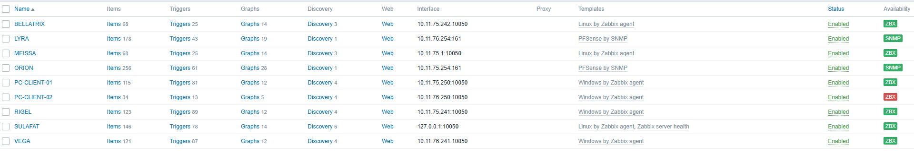

### Tests et Validation

| Test | Résultat attendu | Statut |
|:-----------------------------------:|--------------------------|--------|
| 9 hôtes actifs dans Zabbix | Tous "Enabled" et "Available" | ✅ |
| Métriques RIGEL (via tunnel IPsec) | Graphiques CPU/RAM visibles | ✅ |
| Métriques VEGA (réseau local) | Graphiques visibles | ✅ |
| Métriques MEISSA (via tunnel IPsec depuis DMZ) | Graphiques visibles | ✅ |
| Arrêt d'un agent | Alerte "Problem" dans le dashboard | ✅ |

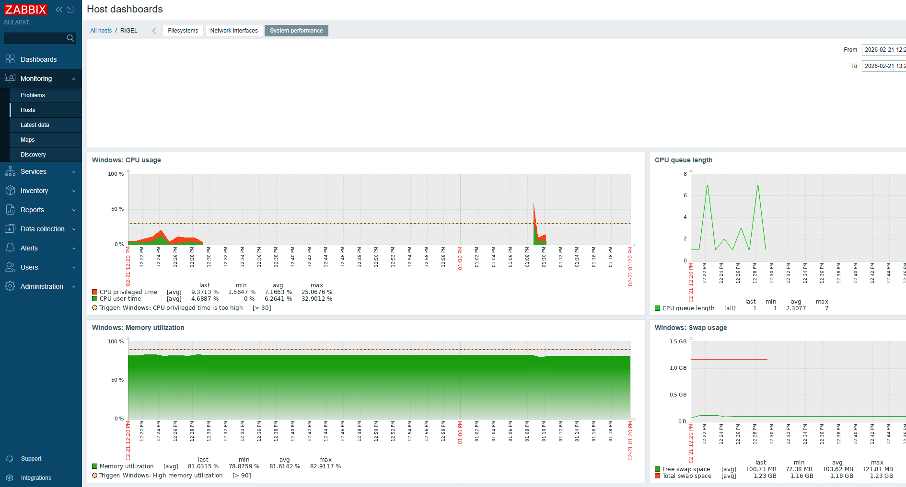

## Gestion de Parc et Services Centralisés – BELLATRIX

### Étude du Besoin

En complément de la supervision temps réel assurée par Zabbix (SULAFAT), le service IT a besoin d'un outil de gestion de parc pour maintenir un inventaire à jour de l'ensemble du matériel et des logiciels, suivre le cycle de vie des équipements et centraliser les demandes d'assistance via un système de ticketing. La base d'utilisateurs doit être synchronisée avec l'annuaire Active Directory.

BELLATRIX héberge deux services : GLPI pour la gestion de parc (accessible sur le port 8080) et un portail d'administration centralisé (accessible sur le port 80) servant de point d'entrée unique vers les outils IT.

### Installation de GLPI

GLPI a été déployé sur BELLATRIX avec une stack LAMP. La pile Apache, MariaDB et PHP (avec les modules requis : mysql, gd, xml, bcmath, mbstring, ldap, curl, zip, intl) a été installée en prérequis.

L'archive GLPI a été téléchargée depuis le dépôt GitHub officiel et extraite dans `/var/www/html/glpi`. Les permissions du répertoire ont été attribuées à l'utilisateur www-data pour permettre à Apache d'y accéder.

Un virtual host Apache a été configuré pour servir GLPI sur le port 8080, le port 80 étant réservé au portail d'administration.

Une base de données dédiée a été créée dans MariaDB avec un utilisateur disposant des privilèges restreints à cette base. L'assistant d'installation web a finalisé la configuration.

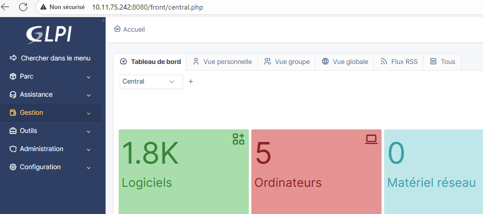

### Connexion à l'Annuaire via LDAPS

Pour synchroniser automatiquement les comptes utilisateurs, une liaison LDAPS (port 636) a été configurée vers l'annuaire Active Directory. Le chiffrement SSL garantit que les identifiants ne transitent pas en clair sur le réseau.

**Configuration dans GLPI (Configuration > Authentification > Annuaires LDAP) :**

| Paramètre | Valeur |
|:--------------:|-------------------------------------------|
| Serveur primaire | 10.11.75.241 (RIGEL) |
| Serveur secondaire | 10.11.76.241 (VEGA, fallback via IPsec) |
| Port | 636 (LDAPS) |
| Base DN | DC=galaxynl,DC=lan |
| Filtre de connexion | (&(objectClass=user)(!(objectClass=computer))) |
| Champ de login | sAMAccountName |
| Compte de liaison | CN=svc-glpi,OU=IT,OU=G_Utilisateurs,DC=galaxynl,DC=lan |

Un compte de service dédié (svc-glpi) a été créé dans l'Active Directory avec des droits de lecture seule sur l'annuaire, conformément au principe du moindre privilège. Le serveur secondaire (VEGA) assure la continuité du service d'authentification en cas de défaillance de RIGEL ou du tunnel IPsec. La règle de filtrage correspondante est documentée en section 9.4 (interface IPsec de LYRA).

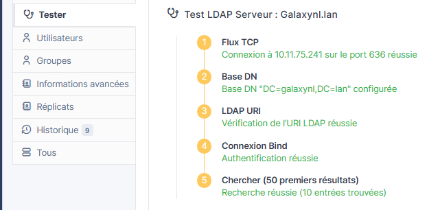

### Déploiement de l'Agent GLPI

L'agent GLPI (successeur de FusionInventory Agent) a été déployé selon la même stratégie que pour Zabbix : installation manuelle sur les serveurs, déploiement automatisé par GPO sur les postes clients.

Sur les serveurs Linux, le paquet glpi-agent a été installé depuis les dépôts. Sur les serveurs Windows (RIGEL, VEGA), le MSI GLPI Agent a été installé manuellement.

Pour les postes clients du domaine, le package MSI a été placé sur le partage `\\RIGEL\Deploiement\GLPIAgent\` et une GPO de script de démarrage a été créée et liée à l'OU Ordinateurs.

Tous les agents sont configurés pour remonter l'inventaire vers http://10.11.75.242:8080/glpi. Les machines du Bâtiment 2 atteignent BELLATRIX via le tunnel IPsec, les règles de filtrage correspondantes étant documentées en section 9.

### Inventaire Automatique

Après déploiement des agents, l'inventaire GLPI se peuple automatiquement avec l'ensemble des machines de l'infrastructure :

| Machine  | OS              | Type | Méthode |
|:------------:|---------------------|----------|-------------|
|    RIGEL     | Windows Server 2025 | Serveur  | Manuelle    |
|     VEGA     | Windows Server 2025 | Serveur  | Manuelle    |
|    MEISSA    | Ubuntu 24.04        | Serveur  | Manuelle    |
|  BELLATRIX   | Ubuntu 24.04        | Serveur  | Manuelle    |
|   SULAFAT    | Ubuntu 24.04        | Serveur  | Manuelle    |
| PC-CLIENT-01 | Windows 11          | Poste    | GPO         |
| PC-CLIENT-02 | Windows 11          | Poste    | GPO         |

### Portail d'Administration Centralisé

Un portail web centralisé a été déployé sur BELLATRIX (port 80) pour simplifier l'accès quotidien aux outils d'administration. Il s'agit d'une page HTML servant de point d'entrée unique pour l'équipe IT, regroupant les liens vers l'ensemble des interfaces de gestion :

|   Outil   | URL                    |
|:-------------:|----------------------------|
|     GLPI      | http://10.11.75.242:8080   |
|    Zabbix     | http://10.11.76.242/zabbix |
| pfSense ORION | https://10.11.75.254       |
| pfSense LYRA  | https://10.11.76.254       |

Ce portail est accessible à l'adresse http://10.11.75.242 et n'est joignable que depuis le VLAN IT (VLAN 40), conformément à la politique de filtrage définie en section 9.


## Bilan et Perspectives

### Synthèse des Réalisations

Ce projet a permis de concevoir, déployer et documenter une infrastructure réseau multisites complète pour ORION CONSULTING GROUP :

| Couche | Réalisations |
|:--------------:|--------------------------------------------------------|
| Réseau | Segmentation 802.1Q (8 VLANs), routage inter-VLAN, DHCP, plan d'adressage VLSM en /28 |
| Sécurité périmétrique | Pare-feux pfSense avec politique Least Privilege, DMZ isolée, VPN IPsec site-à-site |
| Sécurité réseau | Filtrage granulaire par VLAN avec alias pfSense, isolation totale du WiFi et de la DMZ |
| Identité | Active Directory multi-sites (RIGEL + VEGA), DNS intégré, structure OU, méthode AGDLP (GL_/GG_) |
| Services de fichiers | DFS Namespaces (`\\galaxynl.lan\Partages`) + DFS Replication inter-sites, permissions NTFS via AGDLP |
| Services web | Site vitrine Nginx en DMZ avec NAT depuis le WAN |
| Supervision | Zabbix Server 7.0 (SULAFAT, Bât. 2) avec agents sur 9 machines (manuels sur serveurs, GPO sur clients) |
| Gestion de parc | GLPI (BELLATRIX, port 8080) avec liaison LDAPS et inventaire automatique |
| Administration | Portail web centralisé (BELLATRIX, port 80), mappage des lecteurs réseau par GPO avec Item-Level Targeting |

### Points d'Amélioration et Évolutions Prévues

Plusieurs axes d'amélioration ont été identifiés pour faire évoluer l'infrastructure :

- **Déploiement automatisé des postes (WDS)** : Installation du rôle Windows Deployment Services sur RIGEL pour automatiser le déploiement des postes Windows 11 via PXE, permettant de standardiser les images et réduire le temps de mise en service.
- **HTTPS sur le site vitrine** : Activation du chiffrement TLS sur MEISSA via un certificat auto-signé ou Let's Encrypt.
- **DNS over HTTPS (DoH)** : Activation du DoH sur les contrôleurs de domaine pour tirer parti des fonctionnalités natives de Windows Server 2025.
- **Filtrage de la navigation web** : Déploiement d'un proxy Squid pour le filtrage applicatif (couche 7) des URL, complétant le filtrage réseau (couche 3/4) assuré par pfSense. Les contraintes de ressources actuelles (2 Go RAM par VM) n'ont pas permis cette implémentation, qui pourrait être envisagée avec une augmentation des ressources allouées.
- **Alerting Zabbix** : Configuration de notifications par e-mail ou webhook (Teams, Slack) pour l'alerte en temps réel.
- **Sauvegarde** : Stratégie de sauvegarde de la base NTDS, des configurations pfSense et des bases de données GLPI/Zabbix.
- **Durcissement GPO** : Stratégies de complexité de mots de passe, verrouillage automatique, restriction USB.
- **Séparation données/système** : En production, les partages de fichiers et les bases de données seraient placés sur des disques dédiés (D:) pour faciliter les sauvegardes et protéger l'OS. 
- **Trunking 802.1Q** : La mise en place effective des VLANs sur les postes clients, actuellement limitée par l'environnement de l'établissement, permettrait de supprimer les règles de filtrage temporaires et d'activer pleinement la segmentation réseau.
